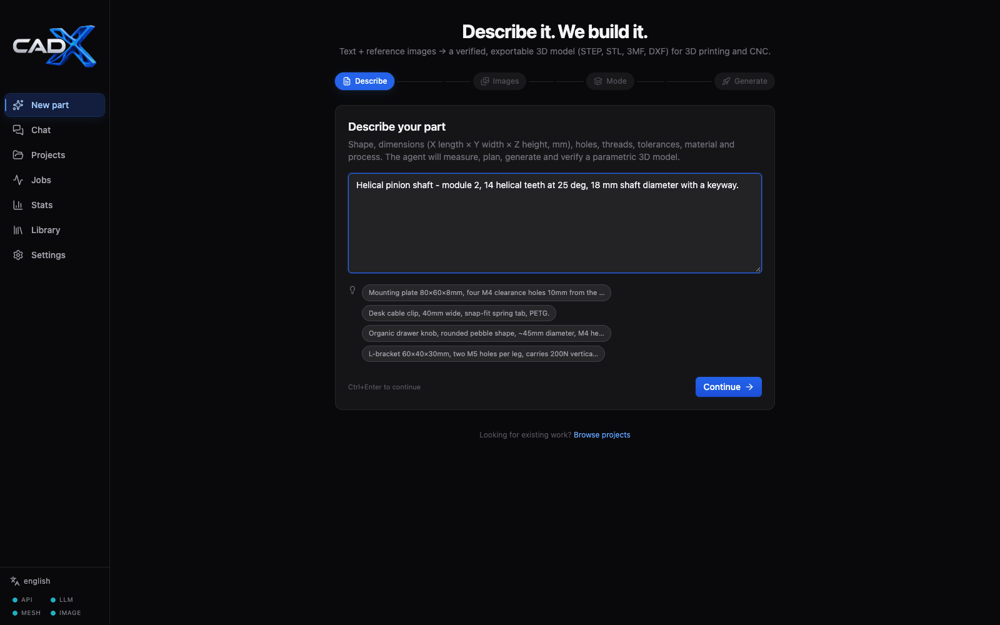
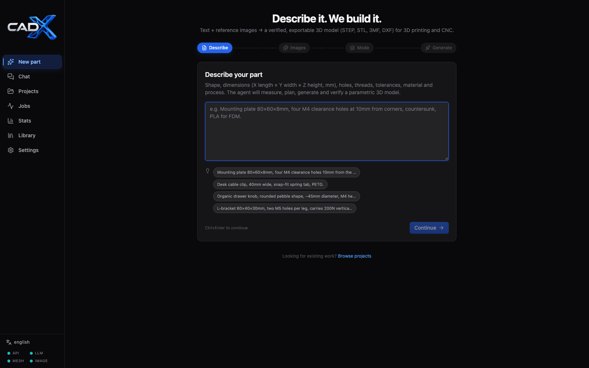
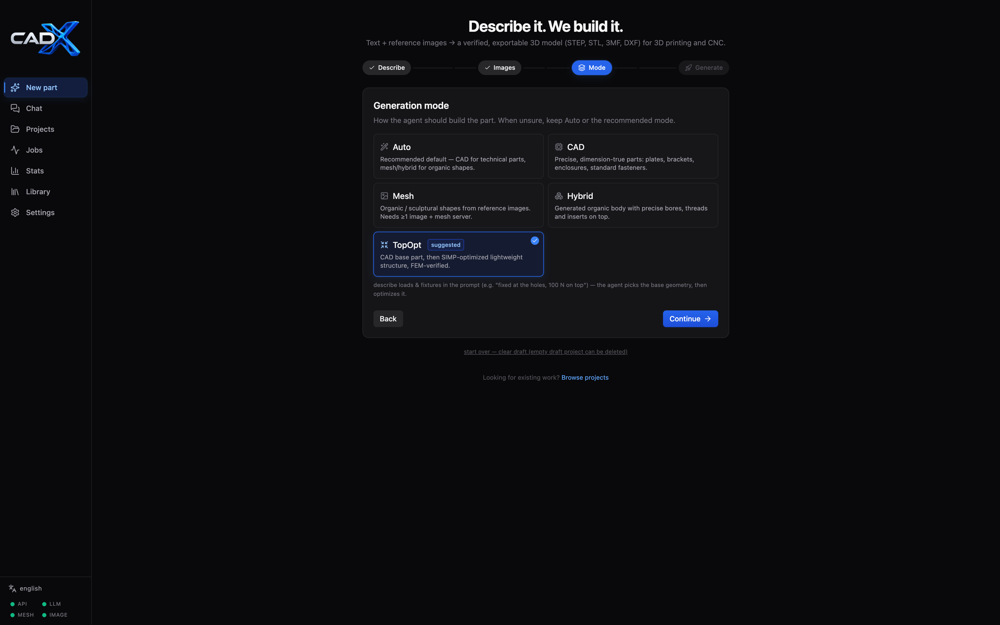
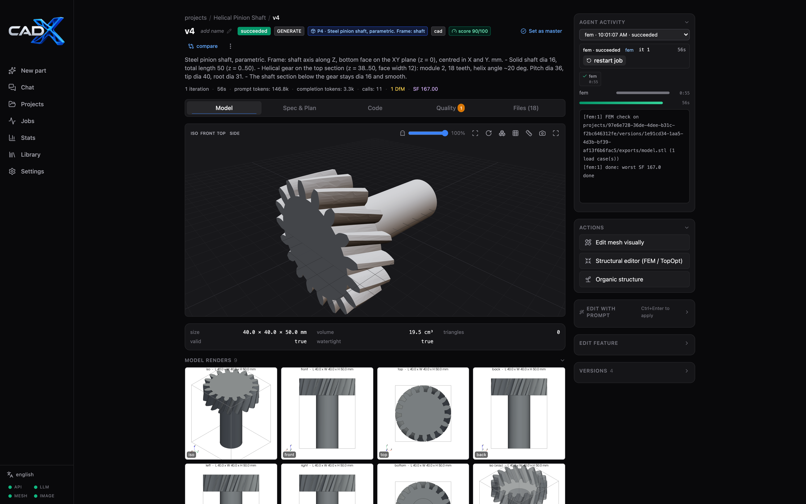
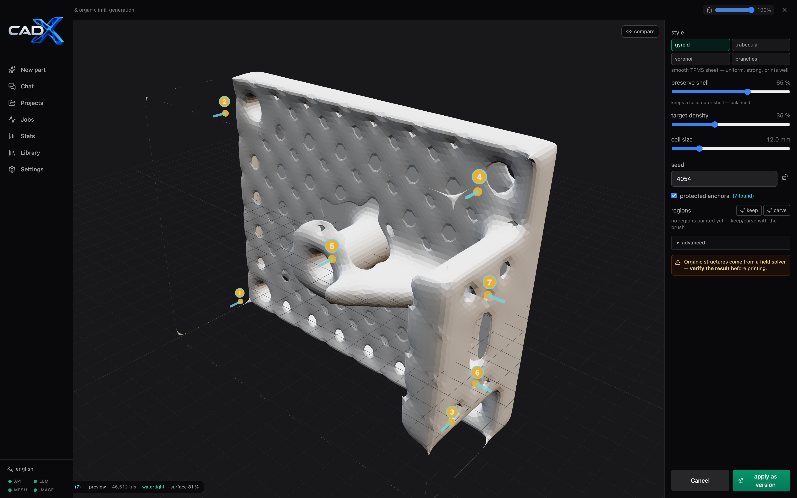
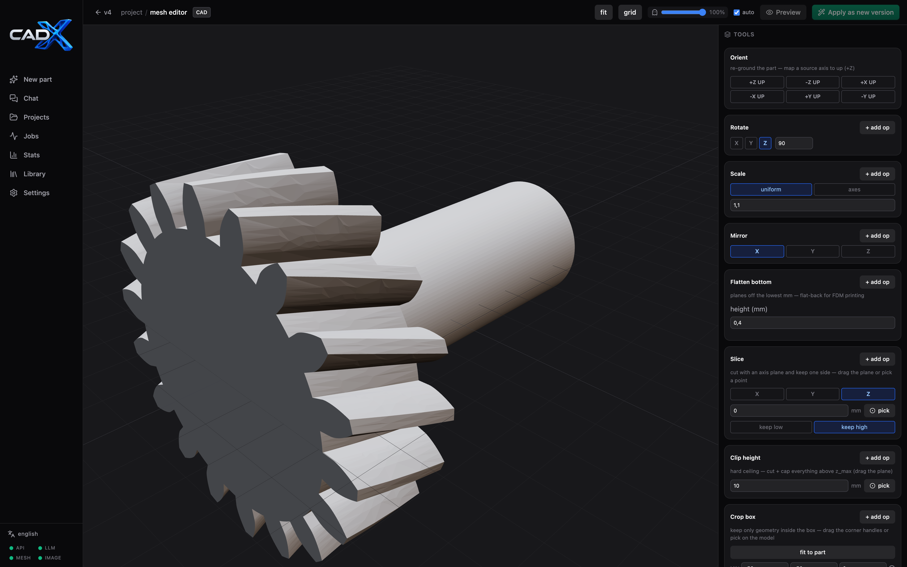
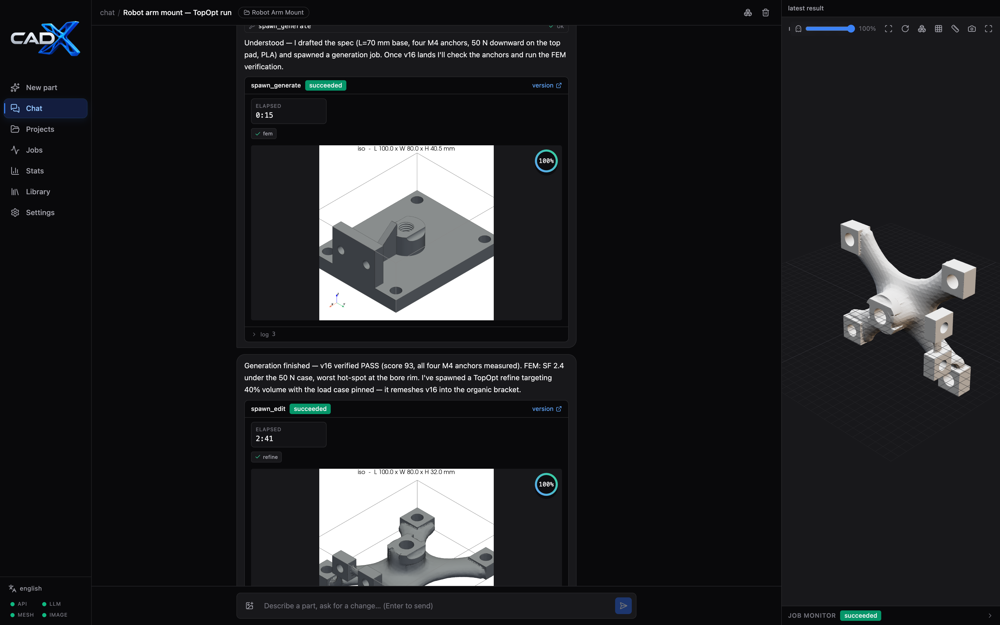
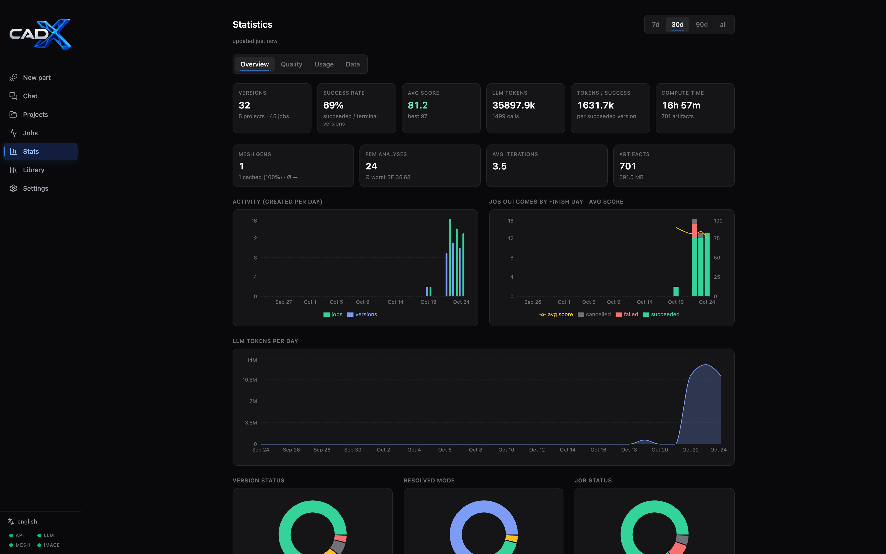
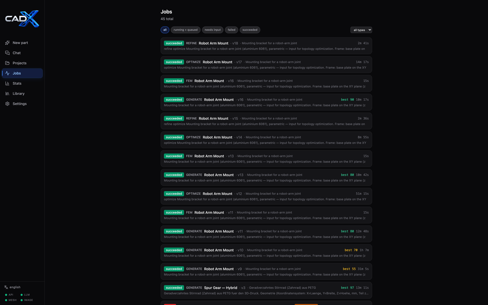
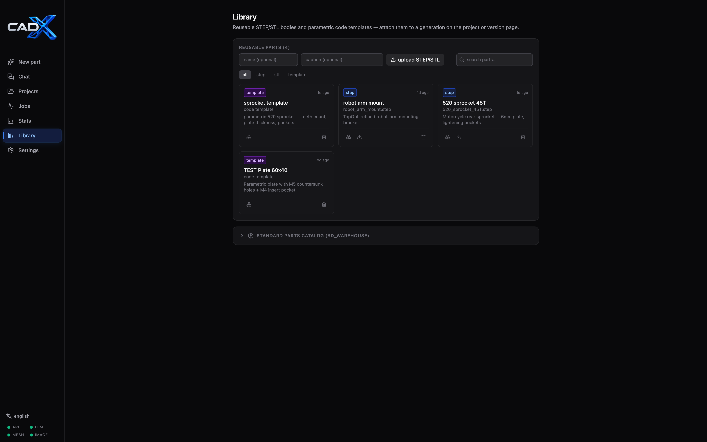

<p align="center">
  
</p>

<h2 align="center">Photos &amp; a prompt in — verified, parametric, manufacturing-ready CAD out.</h2>

<p align="center">
  CADX is a <b>local-first, open-weights</b> multimodal CAD agent. Feed it reference
  photos, drawings or sketches plus a prompt with dimensions — it iterates
  <i>generate → execute → measure → critique → repair</i> until the part checks out
  against your spec. The result is parametric build123d <b>code</b> with real
  manufacturing exports — not just a mesh.
</p>

<p align="center">
  <a href="LICENSE"></a>
  
  
  
  
  
</p>

<p align="center">
  <a href="#quickstart">Quickstart</a> ·
  <a href="#why-cadx">Why CADX</a> ·
  <a href="#showcase">Showcase</a> ·
  <a href="#features">Features</a> ·
  <a href="#modes">Modes</a> ·
  <a href="#mcp-server">MCP</a> ·
  <a href="#documentation">Documentation</a> ·
  <a href="#license">License</a>
</p>

<p align="center">
  
  <br>
  <sub><i>Describe → images → mode → review — and out comes a verified, parametric part.</i></sub>
</p>

> [!WARNING]
> **Early development** — CADX is under active development. Expect breaking
> changes, rough edges and an evolving API/data model between versions.
> Feedback and bug reports are very welcome.
>
> **Hardware coverage:** developed and tested on Apple Silicon (64 GB,
> MLX/MPS) only so far — CPU-only works in CAD mode. The NVIDIA **CUDA** and
> AMD **ROCm** tiers are implemented and mock-tested, but not yet validated
> on actual GPU hardware — expect a report/fix round on first contact.

---

## Why CADX

Most image→3D tools hand you a mesh and wish you luck. CADX closes the loop.

| Typical AI→3D tools | CADX |
|---|---|
| A frozen triangle mesh | **Parametric build123d code** — diffable, re-runnable, "make it 5 mm taller" is a one-line edit |
| "Looks about right" | **Measured and critiqued** — holes ray-checked for real through-paths, features verified, renders vision-scored, `verify_spec` reports PASS / FAIL / UNVERIFIED |
| Whatever the mesh happened to produce | **Real machining intent** — catalog standard parts, true ISO threads on export, counterbores/sinks, heat-set inserts, bearings — with a BOM |
| No idea whether it survives | **Voxel FEM + topology optimization** — explicit load cases, safety factors verified on the exported solid |
| Cloud API or nothing | **Open-weights, local-first** — MLX on Apple Silicon, CUDA, ROCm, or CPU-only CAD; your LLM endpoint, your keys |

## Quickstart

```bash
./scripts/start.sh    # or: make start
```

The first run auto-detects your GPU tier (MLX / CUDA / ROCm / none), installs the
matching mesh adapter and brings up the whole stack — docker services plus the
native mesh-server sidecar. Open **http://localhost:8080** → **Settings** and
point it at your LLM provider (Ollama, LM Studio, vLLM, OpenAI, OpenRouter —
anything OpenAI-compatible); everything else works out of the box.

The landing page is a guided wizard — describe the part, drop in reference
images (or generate a concept image locally), pick a mode, review — and live
progress renders right there until the model is done. Existing work lives
under **Projects**.

```bash
scripts/status.sh            # health of all components   (make status)
scripts/stop.sh              # stop everything            (make stop)
scripts/setup.sh --doctor    # diagnostics
```

Full install, dev-mode and migration docs:
**[docs/getting-started.md](docs/getting-started.md)**.

## Showcase

<p align="center">
  
</p>

<table>
  <tr>
    <td width="33%"></td>
    <td width="33%"></td>
    <td width="33%"></td>
  </tr>
  <tr>
    <td align="center"><sub>Guided new-part wizard</sub></td>
    <td align="center"><sub>Version detail — measured geometry</sub></td>
    <td align="center"><sub>Organic restyle — live preview</sub></td>
  </tr>
  <tr>
    <td width="33%"></td>
    <td width="33%"></td>
    <td width="33%"></td>
  </tr>
  <tr>
    <td align="center"><sub>Visual mesh editor</sub></td>
    <td align="center"><sub>Structural editor — paint-on regions</sub></td>
    <td align="center"><sub>Chat agent</sub></td>
  </tr>
  <tr>
    <td width="33%"></td>
    <td width="33%"></td>
    <td width="33%"></td>
  </tr>
  <tr>
    <td align="center"><sub>Statistics — tokens, scores, FEM</sub></td>
    <td align="center"><sub>Jobs — live progress and control</sub></td>
    <td align="center"><sub>Library — reusable parts</sub></td>
  </tr>
</table>

Full GUI walkthrough: **[docs/webgui-ux.md](docs/webgui-ux.md)**.

## Features

Everything that ships in the box, at a glance:

| | |
|---|---|
| 🧩 **Generation** | Five modes — `auto` · `cad` · `mesh` · `hybrid` · `topopt` — plus deterministic **organic restyle** (gyroid / trabecular / voronoi / branches) and **mesh→parametric** reconstruction that turns a mesh back into editable code |
| 🖼️ **Inputs** | Reference photos · marked sketches routed to scribble adapters · multi-view sets · locally generated concept/hero images with vision verification · STEP/STL reference bodies and library parts |
| 🔁 **Agent loop** | intake → plan → codegen → sandboxed exec → measure → critique → repair; patch-based edits, dimension autofix without an LLM call, staged feature-by-feature builds, adaptive reasoning escalation |
| ✅ **Verification** | Measured geometry (through-holes proven by tunnel rays, countersinks, threads, wall thickness), spec-conformance report, multi-view vision critique, STEP roundtrip gate, design audits that perturb `PARAMS` |
| ⚙️ **Real CAD** | Parametric build123d B-Rep · standard-parts catalog + BOM (screws, nuts, inserts, bearings) · true ISO threads in export mode · reviewed `cadlib` helper library · parameter-only reruns |
| 🏗️ **Structural** | Voxel FEM with explicit load cases and safety factors (CHOLMOD / SuperLU / PyAMG) · SIMP + BESO topology optimization (MMA, robust 3-realization, Helmholtz/Heaviside filters, self-support, multires, symmetry, load-path certificate) · shell+infill lattices · **refine** re-cuts bores/threads as analytic faces |
| 🛠️ **Editors** | Visual mesh editor (slice · clip · crop · boolean · drill · shell · remesh · symmetrize — live preview, reorderable op stack) · paint-on structural editor (load/fix/keep regions, 3D FEM overlay) · organic editor · measured-feature resize · param panel |
| 🤖 **Models** | Open-weights sidecar — image→3D: TripoSG (+scribble), Hunyuan3D-2.1 / 2mv / Omni, Step1X-3D, TRELLIS.2, Tripo3D cloud · text→image/edit: Z-Image-Turbo, FLUX.1-schnell/Kontext, FLUX.2-klein, Qwen-Image(+Edit Lightning), SDXL, SD1.5 · local LLM hosting via mlx-lm / mlx-vlm / llama.cpp |
| 🖥️ **Web app** | Guided wizard · version tree with compare · live in-loop renders and job log (tokens, ETA, step timeline) · jobs + stats dashboards · asset image editor (crop/mask/bg-removal) · parts library · chat agent · **9 locales** |
| 🔌 **Integrations** | REST + SSE API · **MCP server** (stdio + Streamable HTTP, strictly LLM-free) · `cadx` CLI · evalkit with durable runs, gates and baselines |
| 🔄 **Ops** | One-command start with GPU autodetect · self-update from GitHub with rollback · watchdog + job recovery · pg_dump backups · Fernet-encrypted secrets · cgroup-aware CPU/RAM budgets |

> DfM results are engineering heuristics, not a manufacturing guarantee — always
> verify dimensions and process limits yourself before cutting or printing.

## Modes

| Mode | Pipeline | Output |
|------|----------|--------|
| `cad` | build123d code → analytic B-Rep | exact STEP + all exports |
| `mesh` | image→3D model → trimesh pipeline | STL/3MF/GLB (+ tessellated STEP when convertible) |
| `hybrid` | mesh → faceted B-Rep solid → build123d booleans | organic shape with exact machined features |
| `topopt` | base CAD → SIMP on a voxel domain → FEM verify | optimized mesh + density/history artifacts; the refine pass re-cuts bores/threads as analytic STEP faces |
| `auto` | planner picks per spec | — |

A finished version can also be **restyled** into a deterministic organic
structure (gyroid, trabecular, voronoi, branches) — an aesthetic
transformation, not a structural optimization
([docs/organic.md](docs/organic.md)).

`mesh`/`hybrid` require an installed adapter and fall back to CAD cleanly when
the mesh server is unreachable — see
[docs/mesh-generation.md](docs/mesh-generation.md).

## How it works


Each iteration of the agent loop writes build123d code, executes it in a
**sealed subprocess** (AST import allowlist, resource limits, read-only
`no-new-privileges` container), measures the geometry — through-holes,
countersinks, wall thicknesses — renders it for a vision critique, then repairs
or regenerates until the spec checks out.

Details: **[docs/architecture.md](docs/architecture.md)** ·
**[docs/agent-loop.md](docs/agent-loop.md)**.

## MCP server

External agents can drive CADX over the
[Model Context Protocol](https://modelcontextprotocol.io) — **strictly
LLM-free**: the agent writes build123d code itself, CADX verifies it
(`check_code`), runs it in the sandbox (`execute_cad`), persists it
(`submit_code`) and exposes mesh/FEM/topopt jobs, assets and the parts
catalog. No MCP tool can trigger the WebGUI's LLM.

```bash
uv run cadx mcp          # stdio transport
uv run cadx mcp --http   # Streamable HTTP on :8001/mcp
```

The main API also serves `/mcp` (gated by `CADX_MCP_TOKEN` when set). Typical
flow: `codegen_contract` → `check_code` → `execute_cad` → `submit_code` →
`wait_job`. Full tool list and semantics:
**[docs/mcp-server.md](docs/mcp-server.md)**.

## Documentation

**[docs/README.md](docs/README.md)** — the full documentation index, grouped by
audience:

- **Run it** — [Getting started](docs/getting-started.md) ·
  [Configuration](docs/configuration.md) ·
  [Updating](docs/updating.md) ·
  [Troubleshooting](docs/troubleshooting.md)
- **Use it** — [Web GUI](docs/webgui-ux.md) ·
  [Chat agent](docs/chat.md) ·
  [Image editing](docs/image-editing.md) ·
  [Image generation](docs/image-generation.md) ·
  [Parts library](docs/parts-library.md) ·
  [MCP server](docs/mcp-server.md) ·
  [E2E checklist](docs/e2e-checklist.md)
- **Understand it** — [Architecture](docs/architecture.md) ·
  [Agent loop](docs/agent-loop.md) ·
  [Mesh generation](docs/mesh-generation.md) ·
  [FEM & TopOpt](docs/fem-topopt.md) ·
  [Organic structures](docs/organic.md) · [DfM](docs/dfm.md) ·
  [Prompts](docs/prompts.md) · [HTTP API](docs/api.md) ·
  [mesh-server API](docs/mesh-server-api.md) · [Evaluation](docs/eval.md) ·
  [Roadmap](docs/roadmap.md)

<details>
<summary><b>Project layout</b></summary>

| Path | Contents |
|------|----------|
| `backend/` | FastAPI app, agent loop, CAD pipeline, CLI (`cadx`) |
| `frontend/` | React/Vite/Three.js web GUI |
| `mesh_server/` | image→3D + text→image + local-LLM sidecar (own uv project) |
| `scripts/` | `setup.sh` / `start.sh` / `stop.sh` / `status.sh` |
| `docs/` | documentation |
| `data/` | projects, library, models, caches (runtime data) |

</details>

<details>
<summary><b>Development</b></summary>

```bash
make sync && make test && make lint          # backend deps, tests, lint
cd mesh_server && uv run pytest              # sidecar suite
cd frontend && npx tsc --noEmit              # frontend typecheck
cd frontend && npm run lint && npm test      # eslint (react-hooks) + vitest
```

See [CONTRIBUTING.md](CONTRIBUTING.md) for the workflow and
[AGENTS.md](AGENTS.md) for the coding rules.

</details>

## Limitations

- Developed and tested on Apple Silicon (64 GB, MLX/MPS) only; the CUDA and
  ROCm paths are implemented but not yet validated on real GPU hardware.
- Single-user, local operation (no auth) — don't expose it to a network.
- FEM/TopOpt is a simplified linear-elastic voxel analysis, not a certified
  structural solver; organic restyling is aesthetic only —
  [docs/fem-topopt.md](docs/fem-topopt.md) ·
  [docs/organic.md](docs/organic.md).
- Mesh/hybrid STEP base bodies are tessellated (faceted); the refine pass
  re-cuts declared bores/threads/seats as analytic faces on topopt/refine
  children — per-feature timeout degrades to the faceted STEP with a
  warning.
- `load_reference` supports STEP and STL; DXF assets are documentation only.
- One CAD kernel: build123d.

## License

[PolyForm Noncommercial 1.0.0](LICENSE) — free for personal, research,
educational and other noncommercial use; commercial use requires a separate
license (contact the author). Note that downloadable generation models carry
their own licenses (Hunyuan Community License excludes the EU/UK/South Korea);
TRELLIS.2, TripoSG and FLUX.1-schnell are MIT/Apache-2.0.
