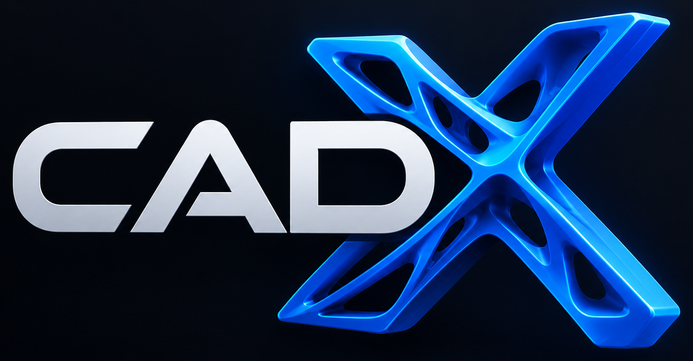

# Documentation

CADX turns reference images and a text prompt into parametric, verified 3D
models for 3D printing and CNC. This index groups the documentation by
audience; start with [Getting started](getting-started.md) if you are new.

## Getting started

| Doc | Contents |
|-----|----------|
| [Getting started](getting-started.md) | Prerequisites, one-command install, GPU tiers, docker vs. native dev mode, first run |
| [Configuration](configuration.md) | Authoritative reference for all runtime settings, project options and environment variables |
| [Troubleshooting](troubleshooting.md) | Diagnostics (`--doctor`, `status.sh`) and common failures |

## Using CADX

| Doc | Contents |
|-----|----------|
| [Web GUI](webgui-ux.md) | Pages and workflows: projects, versions, mesh editor, structural editor, settings |
| [Image editing](image-editing.md) | Crop/mask/background-removal of reference images before generation |
| [Image generation](image-generation.md) | Local text-to-image adapters, concept/hero images, image edits, sketches |
| [Parts library](parts-library.md) | Standard-part catalog, `cadlib` helpers, user library, BOM |
| [E2E checklist](e2e-checklist.md) | Manual browser smoke test of the whole stack |

## Generation modes

| Doc | Contents |
|-----|----------|
| [Mesh generation](mesh-generation.md) | `cad`/`mesh`/`hybrid`/`auto` modes, adapters, candidate screening, post-processing |
| [FEM & TopOpt](fem-topopt.md) | Voxel FEM, SIMP topology optimization, load-case contract, limitations |
| [DfM checks](dfm.md) | FDM/CNC manufacturability heuristics |

## Internals & reference

| Doc | Contents |
|-----|----------|
| [Architecture](architecture.md) | Services, request flow, code and data layout, security model |
| [Agent loop](agent-loop.md) | State machine, tool sessions, step reference, budgets |
| [Prompts](prompts.md) | Prompt files under `backend/cadx/agent/prompts/` and their conventions |
| [HTTP API](api.md) | Backend REST endpoints grouped by router |
| [mesh-server API](mesh-server-api.md) | Sidecar contract (mesh + image jobs) |
| [Evaluation](eval.md) | `cadx eval` benchmark harness and benchmark format |
| [Roadmap](roadmap.md) | Shipped milestones and remaining backlog |

## Component READMEs

- [`mesh_server/README.md`](../mesh_server/README.md) — the image→3D sidecar:
  adapters, install scripts, env configuration, CLI.
- [`AGENTS.md`](../AGENTS.md) — working rules for coding agents in this repo.
- [`CONTRIBUTING.md`](../CONTRIBUTING.md) — development setup and conventions.
