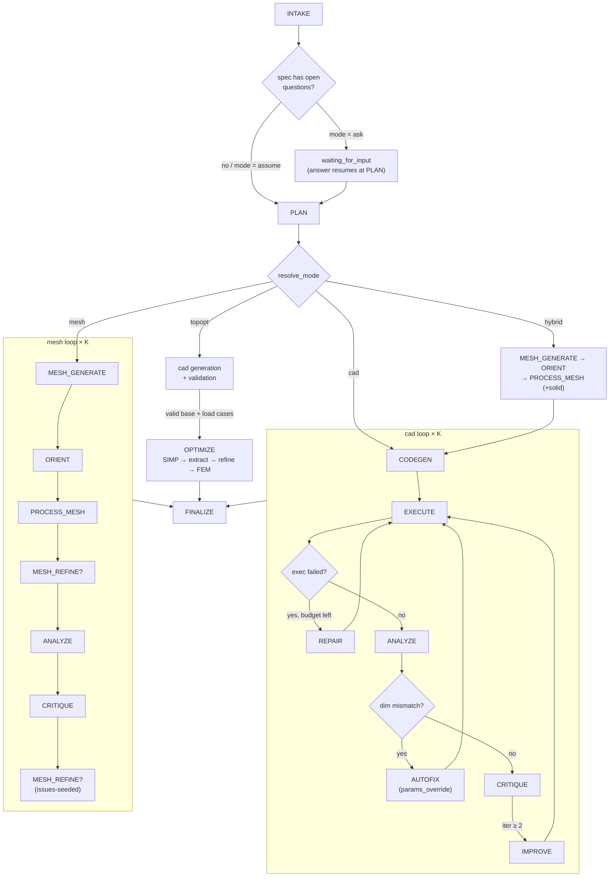

# Agent loop

State machine in `backend/cadx/agent/orchestrator.py`:



Text form:

```
INTAKE → CLARIFY? → PLAN → resolve_mode →
  cad:    [CODEGEN → EXECUTE → REPAIR? → ANALYZE → AUTOFIX? → CRITIQUE → IMPROVE?] × K → FINALIZE
  mesh:   [MESH_GENERATE → ORIENT → PROCESS_MESH → MESH_REFINE? → ANALYZE →
           CRITIQUE → MESH_REFINE?(issues)] × K → FINALIZE
  hybrid: MESH_GENERATE → ORIENT → PROCESS_MESH(+solid) → cad loop with load_mesh_solid()
  topopt: cad generation + validation → SIMP optimization → FEM verification
```

For `cad`/`hybrid` the loop prefers incremental fixes over regeneration:

- **AUTOFIX** (no LLM): when a numeric dim mismatch can be traced to a `PARAMS`
  literal, the code is re-executed with `params_override` first — a second
  LLM call only happens if the auto-fix doesn't resolve it.
- **REPAIR**: an interactive tool session (see below) — the model reads the
  diagnosed line range, applies minimal line/param edits, `check_code`s and
  may `verify` in the sandbox before `done`. Legacy fallback: `PatchResponse`
  (`edits: [{find, replace}]` + `full_code`), retried `agent_patch_retries`×.
- **IMPROVE**: from iteration 2 onward the best-so-far code is fed back with
  a structured issue list (dims, measured features, critique discrepancies,
  DfM warnings) — same tool session, seeded with `ISSUES TO FIX`. After
  `agent_patch_retries` failed attempts the loop falls back to fresh CODEGEN.

`resolve_mode` (in the orchestrator) maps the requested mode (`auto` via the
planner's `plan.approach`, or explicit `cad|mesh|hybrid|topopt`) to the
`resolved_mode`, recording the reason in the job log. Without images
or a reachable mesh server, mesh/hybrid fall back to CAD. `topopt` is a
post-phase: it first generates and validates a base CAD candidate, then runs
SIMP + FEM verification if valid load cases exist.

Each box is a step module in `agent/steps/` that takes `AgentCtx` and returns
a typed result. Every step writes to the `Trace` (persisted as `AgentTrace`
rows) and emits SSE progress events.

## Tool sessions (native function calling)

When `llm_tools` is `auto`/`on`, every step runs an interactive session
instead of one shot: the model calls tools (`agent/toolloop.run_session`),
each result is fed back (`role:"tool"` messages), and the session ends on a
final answer or a `done`/`submit_code` call.

Tools (`agent/toolspecs.py`, primitives in `cad/codeedits.py`):

| Step | Tools |
|------|-------|
| intake / plan | `search_catalog`, `lookup_part`, `cadlib_lookup`, `search_library`, `library_part`, `attach_library_part` |
| codegen | + `check_snippet`, `submit_code` (catalog + library tools too) |
| repair / improve | `read_lines`, `search_code`, `replace_lines`, `insert_after`/`insert_before`, `find_replace`, `set_param`, `check_code`, `verify`*, `render_model`* + catalog/library lookups + `done` |
| critique | `read_lines`, `search_code`, `lookup_part`, `search_library`, `library_part` (read-only — no attach) |
| mesh_refine | `mesh_inspect`, `mesh_preview`* + inspection (`mesh_measure`, `mesh_section`, `mesh_overlay`) + transforms (`mesh_set_up`, `mesh_rotate`, `mesh_mirror`, `mesh_scale`, `mesh_flatten_bottom`, `mesh_slice`, `mesh_crop`, `mesh_clip_height`, `mesh_decimate`, `mesh_smooth`, `mesh_smooth_preserve`, `mesh_remesh`, `mesh_symmetrize`, `mesh_shell`, `mesh_drill_holes`, `mesh_keep_largest`, `mesh_drop_small`, `mesh_repair`, `mesh_boolean_add`, `mesh_boolean_cut`) + `mesh_undo`/`mesh_reset` + `mesh_regen_edit`** + `done` + `regenerate` |
| optimize | `list_anchors`, `check_load`, `preview_regions`, `analyze_fem(load_cases, material?, voxel_mm?)`, `topopt_run(target_volume_fraction?, max_iterations?, keep_regions?, load_cases?, material?, voxel_mm?)` + `done(run_index)` — agent-driven FEM/SIMP parameter search |
| all sessions | `view_image` — re-view an uploaded reference image by `asset_id` (ids are in the "Image N (asset <id>)" context labels; useful when `agent_max_input_images` capped the initial set or a detail needs a second look). The image returns via the `_images` tool-result channel. Info-type sessions additionally get `generate_concept_image` (budget `image_tool_budget`). |

*`mesh_preview` renders the workbench state via the executor
(`process_mesh mode="preview"`) and returns the images as `_images` tool
results — serialised as user messages with image parts, since OpenAI tool
messages can't carry images. Capped at `agent_mesh_preview_max` per session;
a spent budget drops the tool from the schema.

**`mesh_regen_edit` regenerates the mesh from a locally edited reference
image (text→image-edit→mesh) — see
[mesh-generation.md](mesh-generation.md) and
[image-generation.md](image-generation.md).

**Part library tools** (`search_library`, `library_part`,
`attach_library_part`): the user's reusable library (uploaded STEP/STL bodies
and parametric code templates saved from successful versions) is searchable
mid-session. `attach_library_part` adds a file part to `ctx.assets` as a
reference body — `load_reference("<part_id>")` then works in generated code —
or a template's code into `ctx.library_templates`. Attached ids are recorded
on `ctx.library_attached` and merged into `version.library_part_ids` when the
job persists.

*`verify` executes the session buffer in the CAD sandbox (`full_exports=False`)
and returns the error diagnosis or measured geometry — capped at
`agent_tool_verify_max` calls per session, disabled via `agent_tool_verify=false`.
`render_model` runs the same sandbox execution but additionally attaches the
labeled contact-sheet render via `_images`, so the model can *see* the
geometry — both tools share the same execution budget.

Session rules: code is presented **line-numbered** (`NNN │`), line numbers
refer to the current buffer, `done` runs the contract check (failures are fed
back, max 2 re-asks). The advertised tool list is recomputed every turn (a
spent `verify` budget drops the tool from the schema), and calls to tools not
in the session's set are rejected as errors instead of being dispatched.
Budgets: `agent_tool_max_calls` (edit/codegen sessions),
`agent_tool_max_calls_info` (intake/plan/critique). On exhaustion the current
buffer is used when valid; schema-final sessions additionally get one
tools-off "final answer" turn so a burned lookup budget can't fail the step.

Mesh sessions (`kind="mesh"`) have no schema-final answer — `done` submits
the recorded `MeshOp` list and `regenerate` submits a re-roll request; both
end the session. Tool results may carry `_images` (preview renders), which
are forwarded as a following user message with image parts. Caps:
`agent_mesh_tools` (master switch), `agent_mesh_max_ops`,
`agent_mesh_preview_max`, `agent_mesh_refine_rounds`. When the refine session
is unavailable (tools off, vision model stripped, workbench failed to load)
the loop transparently falls back to re-generating with a new seed.

Fallback ladder (`llm_tools=auto`):
1. Provider 400s on `tools` → stripped and recorded **per role**
   (`tools_ok[role]=False`) — a vision model without tool support only falls
   back for intake/critique; codegen/repair/improve still get tools. With
   `llm_tools=on` nothing is stripped: the 400 raises an `LLMError` instead.
2. Model writes its tool call as JSON in `content` → synthesised call, session
   keeps working (results come back as user messages, no `role:"tool"`).
3. Neither → `content` is the final answer, parsed by the step's schema
   (schema re-asks never re-offer tools).

`FakeLLM` scripts use `{"tool_calls": [{...}]}` entries (or
`{"content_tool_call": ...}` for the fallback path); eval benchmarks opt in
via `llm_tools: "auto"`.

## Steps

| Step | LLM? | Purpose |
|------|------|---------|
| INTAKE  | yes (vision) | Extract `Spec`: name, summary, units, dimensions (x/y/z, each with value+source), open questions. Sees all input images. May look up catalog parts via tools. |
| CLARIFY | — | If spec has open questions and project mode is `ask`, the job ends `waiting_for_input` with questions. `assume` mode skips this and lets the LLM state assumptions. `POST /jobs/{id}/answer` resumes the job at PLAN. |
| PLAN    | yes | Construction plan: ordered steps, PARAMS table (name/value/unit/min/max), standard-parts list (bd_warehouse), notes. May query the catalog via tools. |
| CODEGEN | yes | Produce `model.py` honoring the code contract + `expected_bbox` — via `submit_code` in tool sessions (may `check_snippet` first). |
| EXECUTE | no (cad queue) | Sandbox-run the code: shape, analysis, renders, DfM, BOM and exports. |
| REPAIR  | yes | On exec failure, feed diagnosed error (category, failing line, hint) + spec/plan/analysis + numbered code back — interactive edit session (read/search/edit/check/verify/done); legacy `PatchResponse` when tools are off; bounded by `agent_max_repairs`. |
| ANALYZE | no | Compare measured bbox vs spec dims with `dim_tolerance_pct/mm`; detect swapped axes. Also extracts measured features (hole groups/diameters/axes, countersinks, counterbores, rounds, chamfers) via `cad/features.py` and compares them against `spec.features` — findings are feedback only, never a hard gate. |
| AUTOFIX | no | If dim issues remain and `agent_param_autofix`: try `params_override` re-execution before any further LLM call. |
| CRITIQUE| yes (vision) | Contact sheet + input images + measured facts → score 0–100, discrepancies, `feature_verdicts` per spec feature. May inspect the candidate code and real part dims via read-only tools. Empty-discrepancy guard re-asks once when a failing score lists no problems (`agent_critique_reask`). |
| IMPROVE | yes | From iteration 2: feeds best code + structured issues back — interactive edit session (same toolset as repair); legacy `PatchResponse` when tools are off; preserves unrelated features. |
| MESH_GENERATE | no (HTTP) | `MeshPort.generate` → mesh-server job → raw GLB into `iterations/<n>/`. Iterations vary the seed; on a `major` critique failure the hero image rotates. |
| ORIENT | yes (vision) | Once per version: 6 up-axis candidates are rendered in the executor and the vision model picks `MeshOrientation{up,front}`; heuristic/parent fallback otherwise. |
| PROCESS_MESH | no (cad queue) | `run_mesh_pipeline`: `baseline_mesh` (clean → decimate → orient → scale-to-spec → flatten → rest) → recorded `ops` → analysis → renders → DfM(mesh) → exports; `make_solid` additionally writes `_run/model.brep` (faceted solid) for hybrid. `mode="preview"` runs the same baseline + ops and renders 3 views without exports. |
| MESH_REFINE | yes (vision) | Interactive mesh-transformation session (`agent/mesh_tools.py`): the workbench holds the baseline-processed mesh, each `mesh_*` tool applies a validated `MeshOp` and re-grounds the part; `done` submits the op list, `regenerate` asks for a new seed. Runs twice — a shape pass after PROCESS_MESH and issues-seeded repair passes after a failed critique (`agent_mesh_refine_rounds`). Disabled/unavailable → the previous seed-rotation loop. |
| OPTIMIZE | yes (vision) | In TopOpt mode or when requested by plan/options/spec the agent runs an interactive structural session on the best base geometry: `analyze_fem` probes load cases, `topopt_run` executes SIMP+FEM-verify with varied parameters (volfrac, keep regions, material, voxel pitch). Each call occupies its own iteration dir; `done(run_index)` commits the chosen run's artifacts exactly like the deterministic path, `run_index:-1` keeps the base part. Unavailable (tools off/session failed) → single-shot SIMP fallback. Budgets: `agent_struct_tools` (master switch), `agent_topopt_max_runs` (6), `agent_fem_max_runs` (4). |
| FINALIZE| no | Pick best candidate `(no dim errors, −major issues, score)`, copy artifacts, write exports + `model.py`/`params.json`, set status. |

## Edit flow

`POST /versions/{id}/edit` creates a child version (same project, `parent_id`
set). The parent `ParentContext` carries its code, params, spec summary and
contact sheet so the LLM makes *minimal diffs* and keeps PARAMS names stable.
History is a version tree (`VersionTree` in the UI).

For `mesh` parents an edit *regenerates* the mesh (new seed/prompt/images) —
the parent's orientation is reused. For `hybrid` parents the parent's
`mesh/solid.brep` is reused as the base body unless `regenerate_mesh=true`.

## Params-only re-run

`POST /versions/{id}/params` re-executes the parent code with a `PARAMS`
override — no LLM at all. Result is a new child version. For `resolved_mode
== "mesh"` parents it re-runs the mesh pipeline with merged `MeshPostParams`
(scale, up, front, rotate_z, decimate, flatten_bottom, mirror_x, **ops**) on
the parent's `mesh_raw.glb` — the recorded refine-session ops replay
deterministically (`mesh.ops_report` documents each applied op). For hybrid
parents the code re-runs against the parent's `mesh/solid.brep`.

## Termination & status

- `succeeded` — score ≥ `agent_pass_score` and no unresolved dim mismatches.
- `needs_review` — executed fine but below score or with dim deviations.
- `failed` — repair budget exhausted / fatal error.
- `waiting_for_input` — clarification pending.
- `cancelled` — via `POST /jobs/{id}/cancel` (checked between steps).

A terminal job can be replayed via `POST /jobs/{id}/restart`: generate/edit
jobs spawn a sibling version cloned from the original inputs, params jobs a
new params child with the same effective overrides, `code`/`meshgen` jobs
(MCP surface) a fresh child with the same code/mesh request, optimize jobs a
new optimize child of the same parent (replaying the stored
`optimize_request`, falling back to spec-derived load cases), and reexport
jobs simply enqueue another export on the same version. The UI shows a
"restart" button on finished jobs.

Budgets: `agent_max_iterations` (outer loop), `agent_max_repairs` (per
iteration), `agent_patch_retries` (per improve/repair call),
`agent_max_wall_s`, `agent_max_tokens_per_job`. The effective iteration
budget is capped adaptively for simple dimensioned specs (≥2 stated dims +
≤2 features → 5; stated dims + ≤6 features → 15) unless the version/project
sets `max_iterations` explicitly.

Mesh loop hard gates: an iteration counts as a *hard fail* when it produces
dimension issues on a stated spec, or a critique score ≤
`agent_mesh_hard_fail_score` (default 30) with major discrepancies. After
`agent_mesh_hard_fail_limit` (default 3) consecutive hard fails the loop
stops; dimensioned specs fall back to the CAD loop instead of burning more
seeds.

Before the hybrid base-mesh dim gate rejects, a deterministic fit rescues
proportion-off generations (shape right, envelope wrong): bounded per-axis
scale ops (0.4–2.5 planar, 0.2–2.0 thickness). Ops are appended and
re-measured for up to 3 rounds (each round fixes the residual), and recorded
in `post.ops` so params jobs replay them. A fitted candidate whose volume
collapses below ~8% of its own bbox (a crust/sliver) is still rejected.

Robustness plumbing: step events are deduplicated (identical
step/iteration/message repeats are dropped — mesh-server polls otherwise
flood the log), agent traces persist on their own session (a failed
`AgentTrace` insert can no longer poison the job's session), every
`run_*_job` is crash-guarded (unhandled errors mark job+version `failed`
instead of leaving them `running`), a worker-boot reaper fails orphaned
`running` jobs, and jobs refuse to start below 2 GB free disk.

Topology optimization converges early when the compliance objective stalls
(`converge_patience`, default 5 iterations within `tol`), and the SIMP loop
polls the job's Redis cancel key mid-iteration so cancellation lands
promptly instead of after the full run.

Robustness toggles (aimed at weak/local models): `agent_param_autofix`,
`agent_patch_mode` (`auto|always|never`), `agent_feature_feedback`,
`agent_critique_reask`.

Tool sessions: `llm_tools` (`auto|on|off`), `agent_tool_max_calls`,
`agent_tool_max_calls_info`, `agent_tool_max_calls_improve`,
`agent_tool_max_calls_build`, `agent_tool_max_turns`,
`agent_tool_max_turns_edit`, `agent_tool_churn_limit`
(edits-without-check guard), `agent_session_condense_turns`,
`agent_tool_verify`, `agent_tool_verify_max`,
`agent_struct_tools`, `agent_topopt_max_runs`, `agent_fem_max_runs`,
`agent_sigcheck` (pre-execution signature gate), `agent_staged_build`
(`kind="build"` feature-by-feature codegen), `agent_codegen_samples`
(first-iteration tournament), `agent_parametrize`, `agent_design_audit`,
`agent_quickref_context`, `agent_plan_mode` (`full|lite|auto`),
`agent_mesh_shape_guard_iou`. Adaptive reasoning: `llm_thinking`,
`llm_thinking_hard_steps`, `llm_thinking_escalate_after`,
`llm_thinking_max_calls`, `llm_thinking_body_on/_off`,
`llm_degenerate_stall_s`. The full reference is
[configuration.md](configuration.md).

### Recommended settings for local ~27B models

The code defaults assume a strong hosted model. For a local code/vision
model (e.g. qwen3-27b via vLLM) the following values keep sessions
productive and bounded — set via the Settings GUI or `PUT /api/settings`:

| Setting | Recommended |
|---|---|
| `agent_max_iterations` | 12 |
| `agent_tool_max_calls` | 30 |
| `agent_tool_max_calls_info` | 10 |
| `agent_tool_max_turns` | 24 |
| `agent_max_tokens_per_job` | 3,000,000 |
| `agent_max_wall_s` | 3600 |
| `agent_patch_retries` | 3 |
| `agent_pass_score` | 65 |

Every iteration produces a structured `issues` list (dims / measured
features / critique / DfM) that is persisted on `Version.issues` and shown
in the UI quality tab.

## LLM calling discipline

- Every step = fresh `system` + `user` messages; no chat accumulation.
- `llm_json_mode`: `json_object` (default) → `json_schema` → `none`
  (plain prompt); client auto-retries without `response_format` on 400s.
- Structured parsing (`llm/structured.py`) extracts JSON even from fenced
  prose, validates against Pydantic schemas, and re-asks once on failure.
- `FakeLLM` replays a JSON script for deterministic end-to-end runs —
  dev/test only via `cadx run --fake` and eval benchmarks
  (`llm_script`/`llm_tools` fields), not a production runtime option.

## See also

- [Configuration](configuration.md) — every `agent_*` / `llm_*` setting
- [Prompts](prompts.md) — the prompt files behind each step
- [Mesh generation](mesh-generation.md) — the mesh/hybrid pipeline
- [FEM & TopOpt](fem-topopt.md) — the optimize session in detail
