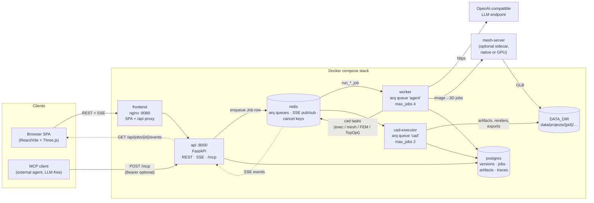
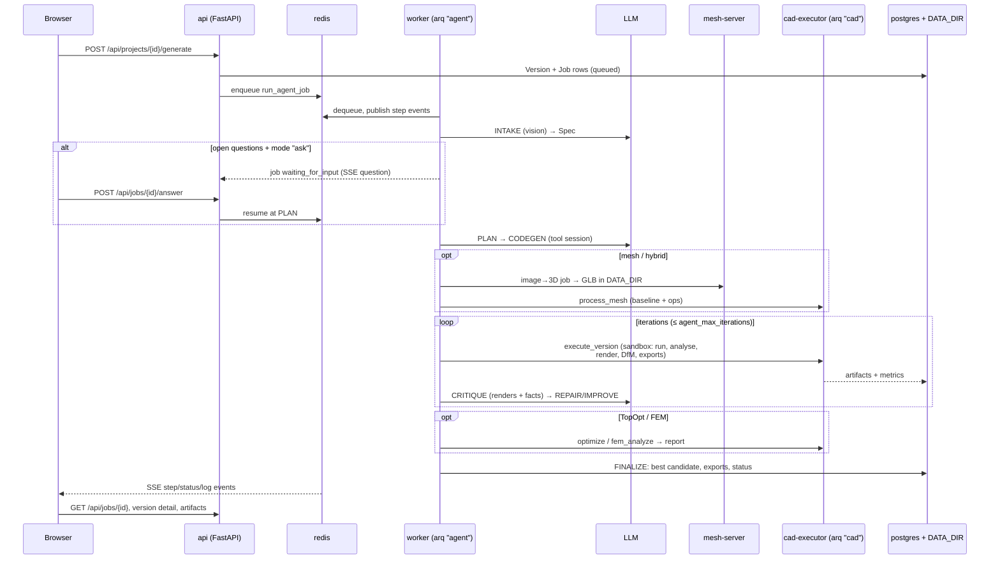

# Architecture

CADX is a local, single-user system that turns multimodal input
(images + text + dimensions) into manufacturing-ready CAD via an
OpenAI-compatible LLM. Generated geometry is build123d *code* — parametric,
diffable, re-runnable.

## Services (docker-compose.yml)

| Service      | Role                                                          |
|--------------|---------------------------------------------------------------|
| `frontend`   | nginx + React/Vite SPA on :8080, proxies `/api/*` (REST + SSE) to `api` |
| `api`        | FastAPI app: projects/assets/versions/jobs, SSE, file serving  |
| `worker`     | arq worker on queue `agent`: runs the LLM agent loop + bounded tool sessions |
| `cad-executor` | arq worker on queue `cad`: sandboxed CAD execution, render, DfM, voxel FEM and SIMP TopOpt |
| `postgres`   | SQLModel/SQLAlchemy database (async)                          |
| `redis`      | arq queues + pub/sub for SSE events                            |
| `mesh-server` | (optional, external) multi-model inference sidecar: image→3D (TRELLIS.2, Hunyuan3D, TripoSG), text-to-image (FLUX, SDXL, Qwen) and **llm** adapters (managed OpenAI-compatible server subprocesses — mlx-lm/mlx-vlm, llama.cpp). Runs **natively** on the host (macOS has no docker GPU) or on a CUDA box (`--profile gpu`). Contract: [mesh-server-api.md](mesh-server-api.md). |

The split between `worker` and `cad-executor` is deliberate: the agent loop
is cheap I/O, while CAD execution is CPU-bound and sandboxed. They scale and
fail independently. The mesh server is deliberately *not* in the default
compose stack — only the worker talks to it (`mesh_base_url` runtime
setting), and generated
GLBs flow to the executor purely through `DATA_DIR` files. Beyond mesh
generation it also hosts local text-to-image and — when
`llm_backend="sidecar"` — the agent's LLM itself via
`POST /v1/chat/completions` (OpenAI-compatible proxy onto managed
mlx-lm/mlx-vlm/llama.cpp server subprocesses). Internally it is a multi-model host:
a memory ledger admits residents only while `mem_headroom_mb` stays free
(measured peak RSS beats declared estimates), LRU-evicts non-pinned models
under pressure, and a model-affine queue prefers jobs matching resident/
warm `gen_worker --serve` workers subject to a fairness cap — see
[mesh-server-api.md](mesh-server-api.md#queue--memory).

## Request flow



Entry points enqueue onto the `agent` queue only — every Job row is owned by
the `worker`; the `cad` queue carries ad-hoc executor tasks
(`QueueExecutor`) with no Job row of their own.

Three enqueue paths share `spawn.py`:

- **Web UI / REST** — generate, edit, params-rerun, optimize, refine,
  resample, mesh_edit, fem, organic, reexport jobs.
- **Chat agent** — `run_chat_turn` drives a `ChatToolSession` whose tools
  spawn the same job kinds mid-conversation.
- **MCP** — `/mcp` (Streamable HTTP) or `cadx mcp` (stdio): external agents
  call `submit_code`/`mesh_generate`/job tools (`code`, `meshgen` job kinds)
  through the same session core — `ctx.llm is None`, so MCP can never reach
  the WebUI's LLM.

### Generation job lifecycle



## Code layout (backend/cadx)

- `agent/` — orchestrator state machine, per-step modules (`steps/`),
  tool sessions (`toolloop.py`, `toolspecs.py`, `mesh_tools.py`), mesh/image
  clients (`mesh_client.py` + `tripo_client.py` — `MeshPort` for sidecar and
  Tripo3D cloud backends, `image_client.py` — `ImagePort` for sidecar and
  OpenAI-compatible images APIs, `concept_image.py`,
  `image_assets.py`), candidate scoring (`mesh_score.py`, `model_pick.py`,
  `anchors.py`), `autofix.py`, `thinking.py` (adaptive reasoning escalation
  policy), `quickref.py` (runtime API signature digests), `featurebind.py`
  (deterministic spec→cadlib snippet binding), `project_tools.py`
  (`ProjectToolSession` + `SAFE_ACTION_TOOLS` — the LLM-free tool core shared
  by chat and MCP), chat agent (`chat_tools.py`, `chat_worker.py` →
  `run_chat_turn`), `executor_client.py` (QueueExecutor → cad-queue tasks),
  `mesh_cache.py` (mesh-server result cache), context/trace/types,
  `worker_jobs.py` (arq job runners for all job kinds)
- `cad/` — sandbox + allowlist, runner_entry, `zygote.py` (warm fork-server:
  pre-imports build123d once, forks an rlimited child per run), engine
  pipeline, analysis,
  exporters, render, contact_sheet, `errordiag.py` (exec-failure
  classification), `patch.py` (find/replace hunks), `codeedits.py`
  (line-edit primitives for tools), `features.py`/`mesh_features.py`
  (measured geometry) + `recognition.py` (quiddity patterns/bosses/fillets),
  `inspect_tools.py` (in-sandbox measure/find_holes/cross_sections helpers
  injected by runner_entry), `verifyspec.py` (canonical conformance report),
  `defects.py` (BRepCheck defect locations + STEP roundtrip gate),
  `design_audit.py` (PARAMS robustness), `editfeature.py` (gated parametric
  hole edits), `compare.py` (shape diff/interference),
  `heightfield.py` (deterministic flat-part solids),
  `mesh_ops.py` (`MeshOp` registry + replay), `mesh_boolean.py` (manifold3d
  boolean backend, loaded in-sandbox), `poshint.py` + `silhouette.py` (image
  position hints / outline extraction), `mesh_payload_entry.py` +
  `mesh_repair_pml.py` (process-mesh task entry, PML mesh repair),
  `dfm/` (common/fdm/cnc/report),
  `fem/` (voxel Hex8 analysis, SIMP TopOpt, mesh extraction, `anchors3d.py`
  mesh anchor scan), `catalog.py`
  (full bd_warehouse registry + lookup/search), `partspec.py` (AST
  validation of standard-part calls), `cadlib/` (reviewed helpers allowed in
  the sandbox), tasks (queue payloads)
- `llm/` — `client.py` (httpx, OpenAI-compatible; `make_llm` is the central
  factory — `llm_backend=external` uses `llm_base_url`/`llm_api_key`,
  `sidecar` points both roles at the mesh-server's `/v1` chat endpoint),
  `structured.py`
  (parse/validate/re-ask), `tools.py` (tool-call parsing/fallbacks),
  `images.py` (EXIF→resize→JPEG→data-URL), `schemas.py` (Pydantic
  contracts), `fake.py` (deterministic test LLM)
- `vision/` — image measurement and outline/anchor extraction
- `api/` — FastAPI routers, schemas, deps
- `db/` — SQLModel tables + async session (migrations live in
  `backend/alembic/`)
- `mcpserver/` — LLM-free MCP server: `server.py` (tool schemas/dispatch on
  the low-level MCP `Server`), `session.py` (`McpToolSession` per transport),
  `http.py` (Streamable-HTTP ASGI app + bearer auth), mounted at `/mcp` on
  the api service and as `cadx mcp` stdio — see
  [mcp-server.md](mcp-server.md)
- `eval/` — benchmark harness (`cadx eval`)
- `spawn.py` — job-spawn helpers shared by REST, chat and MCP
  (`spawn_generate`…`spawn_edit_feature`, `spawn_restart`,
  `enqueue_resume`, `validate_ops`)
- `queue.py` — arq `WorkerSettings` for both queues
- `storage.py`, `config.py`, `runtime_config.py`, `events.py`, `logging.py`,
  `cli.py`, `main.py`

## Data layout

```
data/projects/<pid>/
  assets/<aid>/<file>            uploaded inputs (images, STEP/STL/DXF refs)
  versions/<vid>/
    model.py                     winning generated code (cad/hybrid only)
    params.json                  winning PARAMS values (or mesh post-params)
    spec.json / plan.json        agent intake + plan (via DB too)
    mesh/                        mesh-mode intermediates (see docs/mesh-generation.md)
      mesh_raw.glb               generator output (normalized space)
      mesh_clean.stl             post-processed mesh (mm, oriented, scaled)
      solid.brep                 hybrid: faceted solid for load_mesh_solid()
      mesh.json                  provenance (model, seed, orientation, post params)
    renders/{front,...,iso}.png  best-iteration views
    contact_sheet.png  thumbnail.png
    dfm.json
    bom.json                      standard parts actually instantiated in model.py
                                (namespace scan in runner_entry; also Version.bom)
    fem/report.json             load-case results + stress/deformation renders
    topopt/{density.npz,history.json}  density field + SIMP convergence history
    exports/model.{step,stl,3mf,glb,dxf,svg}
    iterations/<n>/              per-iteration run dir (_run/, renders/, …)
    iterations/0/                hybrid: mesh generation + orientation + solid prep
    _scratch/                    transient GUI previews (ops GLBs, region PNGs)
data/library/<part_id>/<file>    reusable user library (uploaded STEP/STL bodies;
                                parametric code templates are stored in the DB row)
```

## Design decisions

- **Code, not meshes**: LLMs produce build123d source. Parametric `PARAMS`
  dict at top; deterministic rebuilds; cheap edits. Exception: `mesh`/`hybrid`
  modes — see [mesh-generation.md](mesh-generation.md). Hybrid is *CAD-hosted*: the generated
  mesh becomes a faceted B-Rep solid (`load_mesh_solid()`) that build123d
  code modifies via booleans.
- **Bounded LLM sessions**: every step starts with fresh system+user context;
  when enabled, native tool calls run in a budgeted turn loop for targeted
  search/read/edit/check/verify. Provider support is probed per role and falls
  back independently for vision and code models (`llm_tools=auto`).
- **Structured output via JSON mode** with automatic fallback to prompt-only
  JSON (`none`) for providers without `response_format`.
- **Sandboxed execution**: AST allowlist (also rejects known build123d
  pitfalls — discarded `Pos*Primitive` in builders, fillet radius ≥ half the
  box dims, vector-API typos) + restricted import guard + resource limits
  (best-effort on macOS, enforced in Linux containers). When
  `exec_warm_runner` is on, `zygote.py` forks a pre-warmed child per run —
  identical limits, ~3.5 s → ~0.02 s per repeated exec; any zygote failure
  falls back to the cold subprocess. Failed runs report a
  `geometry_at_failure` inventory (where shapes ended up) that feeds the
  repair prompt.
- **Verification loop**: numeric bbox check vs declared spec, 7-view render +
  contact sheet, DfM rules, vision critique. Per-feature checks in
  `verify_spec` compare each stated feature's axis/kind/position against
  measured geometry (slot ≠ round hole; a hole drilled on the wrong axis is
  a deterministic fail; absent evidence → `UNVERIFIED`, never auto-fail).
  Features carry deterministic IDs (`h1`, `s2`, `pk1`, `nt1`, …) stable
  across measurement ordering and re-runs, so issues and edits can name a
  specific hole/slot/pocket. Intake may also declare
  `verification_questions` (≤6, deduplicated, placement-critical) that the
  critique must answer against renders — a `no`, or `unclear` with evidence,
  becomes a major `verify_question` issue and caps the score. In-session
  `verify` uses the engine's `light` path (no renders/DfM) — geometry
  numbers only. Repair sessions converge via per-kind turn caps
  (`agent_tool_max_turns_edit`), a detector that ends a session re-verifying
  the identical error signature, and stall guards that stop or switch
  strategy on repeated signatures, patch misses, or thinking/token budget
  exhaustion. Best candidate across iterations wins, not the last one.
- **Staged build sessions** (`agent_staged_build`): fresh codegen runs a
  `kind="build"` tool session — the model grows a seeded buffer
  feature-by-feature (`add_block`, sandbox `verify` per stage on the light
  pipeline, `checkpoint`/`rollback`, `done` submits the assembled script).
  Failing lines map back to the block that produced them. The final
  contract is unchanged: one runnable file assigning `result`. If the
  session exhausts its turn budget without `done`, a grown buffer is
  submitted anyway (same contract gate); a seed-only buffer still fails.
  `agent_codegen_samples` > 1 runs a first-iteration tournament: N
  independent sessions in parallel, ranked by in-session verification,
  contract status and errors (each candidate gets the full call budget).
- **Static gate + on-demand docs**: generated/edited code passes a
  pre-execution signature gate (`cad/sigcheck.py`) — called names are
  checked against introspected build123d/cadlib signatures; unknown names,
  wrong arity or banned calls fail fast with repair hints instead of
  burning a sandbox exec. Unknown-attribute/name/signature exec errors
  trigger targeted doc injection (`agent/docfetch.py` pulls the relevant
  quickref/introspection entries into the next prompt) instead of always-on
  reference blobs.
- **Prompt layout for prefix caching**: stable job/spec/reference content
  precedes per-iteration code, renders, diagnoses and feedback in every
  step prompt; `LLMResponse.cached_tokens` (provider-reported prefix-cache
  hits) is recorded in traces when nonzero. Long tool sessions run through
  an exchange-level condenser (in `agent/toolloop.py`) that summarizes
  older tool history while never splitting assistant tool calls from their
  results; it is disabled where chat persistence uses positional slices.
- **Canonical conformance**: `verifyspec.py` condenses the executor's
  measured evidence (validity, envelope, feature findings incl. quiddity
  patterns, defects, STEP roundtrip, DfM) into one PASS/FAIL/UNVERIFIED
  report — the canonical `Version.issues` entry — while
  `agent/thinking.py` escalates reasoning depth only on hard steps and
  stall signals instead of paying thinking tokens everywhere. Feature
  evidence also feeds from a bounded face-adjacency graph (in
  `cad/features.py`, lazy networkx, ~600-face cap) that recognises pockets,
  grooves and notches from B-Rep concavity/adjacency — best-effort,
  degrades safely on faceted solids.
- **Mesh → parametric reconstruction**: `parametrize_mesh` /
  `cad/reconstruct.py`+`cad/mesh_to_code.py` turn an input mesh into
  editable build123d code: revolve profiles with bore-aware axis and
  through-bores, extruded prisms, then conservative composite fitting via
  `pyransac3d` (≤6 primitives, deterministic seed, boolean code emission,
  chamfer/self-check rejection) before falling back to the organic path.
- **Verified feature edits**: `POST /versions/{id}/edit-feature` resizes a
  recognised plain through-hole on the stored B-Rep (no LLM); the edit
  commits only if a hard gate passes (volume delta, envelope, other-hole
  invariance, re-recognition, single valid solid) — dependents and faceted
  solids get controlled refusals.
- **Plan-lite**: `agent_plan_mode` (`full`|`lite`|`auto`) — for simple
  image-free CAD jobs a single short no-tools call replaces the catalog-aware
  planner session (`plan_lite_system.md`); `auto` selects it only when the
  planner has no real choice (forced cad, or no mesh/image backends).
- **Parts library, three layers**: (1) the full bd_warehouse catalog is
  introspected once and served to planner/codegen as exact type/size tables
  (`catalog.py`, `partspec.py` validates calls statically pre-execution);
  (2) `cadlib` provides deterministic helpers for recurring geometry so the
  model calls tested macros instead of hand-rolling threads/holes;
  (3) a user library (`LibraryPart` rows + `data/library/`) holds reusable
  STEP/STL bodies and parametric code templates — selected by the user per
  version or by the agent via `search_library`/`attach_library_part` tools,
  then available in generated code through `load_reference(part_id)`.
- **Structural verification and optimization**: optional voxel Hex8 FEM feeds
  stress/safety-factor feedback into the agent; SIMP TopOpt runs as a post-phase
  or an LLM-free child job. Assumptions, API contract, artifacts and limits:
  [fem-topopt.md](fem-topopt.md).
- **Visual editing**: the web GUI ships a mesh editor and a structural editor.
  Both reuse the deterministic executor paths — `MeshOp`/`OPS_REGISTRY`
  replays (`mesh_edit` child versions, `ops_preview` scratch GLBs) and the
  voxel FEM region/preview pipeline (`fem` jobs, `points` regions painted on
  the surface). Preview artifacts live in `versions/<vid>/_scratch/` and are
  served through a whitelisted route; GUI state persists under
  `version.options["ui_editor"]`. See [webgui-ux.md](webgui-ux.md).
- **MCP surface is LLM-free**: `mcpserver/` exposes the same
  `ProjectToolSession` tools (code contract, check/execute, submit, mesh,
  jobs, assets, settings, stats) plus `code`/`meshgen` job kinds — but with
  `ctx.llm = None`; a session tool calling the WebUI's LLM would raise.
  Restart is refused for LLM-generated jobs. Transports: `cadx mcp` (stdio)
  and `/mcp` (Streamable HTTP on the api service; optional
  `CADX_MCP_TOKEN` bearer). See [mcp-server.md](mcp-server.md).
- **Analytic STEP for mesh paths**: refine/topopt children export STEP via
  `export_analytic_step_isolated` — a spawned subprocess per feature with a
  hard timeout (`analytic_step_timeout_s`), BREP checkpoints between
  features, honest degrade to the faceted STEP when a region is
  boolean-pathological. `export_step_checked` reimports the written STEP and
  reverses inverted shells (sewn meshes can flip orientation through the
  STEP writer).
- **Version compare**: `GET /versions/{a}/compare/{b}` diffs two versions
  (volume/bbox/added-vs-removed material via `compare.py`, plus a PARAMS
  diff) — partial `ok:false` results when OCC booleans are skipped. Jobs can
  be `answer`ed (clarify), `cancel`ed, `finish`ed (keep best so far) or
  `restart`ed (sibling replay) from REST, chat and MCP.
- **No auth**: single-user local. The only credential-gated surface is the
  optional `CADX_MCP_TOKEN` bearer on `/mcp`. Do not expose the stack on a
  network.

## Security notes

- `cad-executor` runs generated code: `no-new-privileges`, read-only FS where
  possible, capped CPU/memory/time, allowlisted imports only.
- The LLM API key lives in the `AppSetting` DB row and is never logged or
  returned by the API (settings responses mask it).
- Uploaded files go through `storage.safe_filename`; file serving resolves
  paths under `DATA_DIR` only.

## See also

- [Agent loop](agent-loop.md) — step state machine and tool sessions
- [Configuration](configuration.md) — all runtime settings
- [HTTP API](api.md) — REST endpoint reference
- [mesh-server API](mesh-server-api.md) — sidecar contract
