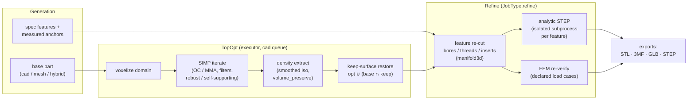
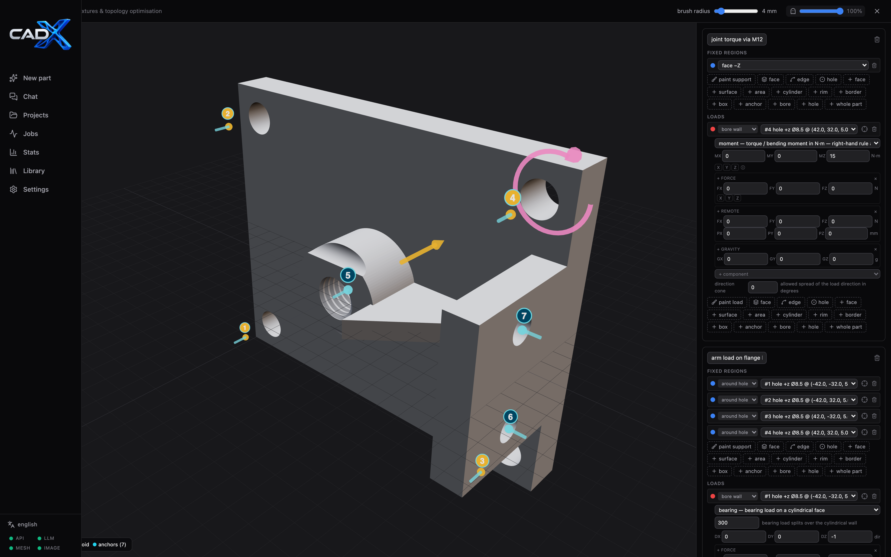

# FEM analysis and topology optimization

The structural workflow adds voxel-based linear-elastic FEM and SIMP topology
optimization to the CAD/mesh generation pipeline. Numerical work runs in
`cad-executor` on the `cad` queue; the LLM worker sends mesh paths and
structured load cases, not generated solver code.

> **Not what you're looking for?** The *Organische Struktur* action
> (`POST /versions/{id}/organic`) is a **procedural pseudo-optimization** —
> it restyles a part into a gyroid/trabecular/voronoi/branches structure with
> no FEM, no load cases and no structural verdict. See
> [Organic structures](organic.md).

## Workflows



### FEM feedback during generation

Describe what is fixed and how the part is loaded in the prompt, or enable
`FEM check` in run options and fill in its load/fixture note. Intake converts
that description into one or more `spec.load_cases`. For every candidate the
agent runs FEM after geometric checks and uses the resulting safety factor and
stress feedback during critique/repair. A missing or unsolvable load case is
reported as a warning; it must not be interpreted as a successful strength
check.

### Autonomous topology optimization

Choose `TopOpt` as the generation mode, or enable topology optimization in run
options. The agent first creates the base geometry, then runs SIMP on its
voxelized material domain and verifies the extracted result with FEM. A
planner may also request this phase. The input geometry bounds the design
space: SIMP removes material inside that domain and does not grow the part
outside it. Fixed, loaded, and explicit `keep_regions` are held solid.

The optimization minimizes compliance across the supplied load cases under a
target volume fraction; per-case `weight` scales each case's objective
contribution, and `LoadSpec.direction_cone_deg` expands a load into sampled
cone directions for direction-robust layouts (capped by
`fem_max_effective_cases`). Cone expansion tilts ALL directional fields of
the load — `force_n`, `moment_nm` and `bearing_dir` — by the same rotation,
so a combined wrench load (force + couple) stays physically coherent under
the robustness envelope. The extracted boundary mesh is regularized for
watertight export. FEM verification uses the corresponding voxel mask rather
than the smoothed export mesh, so export smoothing does not change the
reported structural result.



`optimize.void_regions` pin cells to the void floor (forbidden material —
cable runs, clearance), `optimize.keep_regions` pin cells solid; a keep region
with `material` overrides the per-cell stiffness (insert zones, e.g. a brass
heat-set insert inside a polymer part). `optimize.keep_mode: "auto"` adds a
keep ring around every detected anchor (`topopt_auto_keep_margin_mm`),
`min_member_mm` post-thickens members below the printable floor, and
`density_threshold` sets the extraction iso. The stored `topopt/density.npz`
field can be re-extracted at a different threshold/min-member without a new
SIMP run via `POST /versions/{id}/topopt-resample` (`JobType.resample`).
Re-sampling a **binary** (BESO/0-1) field warns — a different threshold
extracts the same part.

Printability and filter options (`optimize.*`):

- `self_supporting` + `print_direction` — 45° AM filter: a cell is only solid
  when enough material supports it from below along the build direction
  (stencil approximates the 45° overhang rule). Use for support-free FDM.
- `filter: "heaviside"` — cone filter + projected physical density with a
  β-continuation schedule; produces crisp near-0/1 fields whose extraction is
  insensitive to `density_threshold`, at the cost of more iterations.
- `multires` — a coarse SIMP pass at 2× pitch warm-starts the fine grid
  (~3× fewer fine iterations on large parts); skipped below a domain-size
  floor and when an explicit `warm_density_relpath` is given. The report's
  `iterations` counts the finest-grid passes only; `iterations_total`
  adds the coarse pass(es) — that is the wall-clock-relevant number.
- `penal` — SIMP penalization exponent (default 3); leave alone unless
  experimenting.

### Feature finishing (post-TopOpt)

The extracted+smoothed mesh is only approximately exact at functional
interfaces — `POST /versions/{id}/refine` (`JobType.refine`, `VersionKind
.refine` child) deterministically re-cuts them via `cad/fem/refine.py`:

- **Subtractive re-cut** — explicit `features` or auto-resolution from the
  spec's declared `features` merged with scanned anchors produces cutter
  solids (bores, `thread`/`tap` at tap-drill diameter `D − pitch`, inserts
  at `D + 0.1`, bearing seats, countersinks/counterbores) tessellated and
  subtracted with manifold3d booleans at the measured anchor axis/position.
- **Keep-surface restore** — `opt ∪ (base ∩ grown keep-box)` unions the
  ORIGINAL part surface back inside keep regions / anchor rings (Taubin
  smoothing shrinks pinned regions by ~one pitch). Gated by
  `optimize.restore_planes` / the request's `restore_planes` (default on);
  needs the pre-optimization base mesh (resolved from the grandparent for
  topopt children). Patches are validated before unioning — a non-volume or
  empty intersection is skipped with a warning instead of aborting the run.
- **Auto planar restore** — `optimize.auto_plane_restore` /
  `auto_plane_restore` detects dominant planar face clusters on the base
  mesh (normal clustering) and restores them like keep boxes.
- **Helical threads** — `optimize.helical_threads` / request flag cuts a
  real helical groove (swept triangular profile) on `thread` features
  instead of a smooth tap-drill bore (experimental, FDM).
- **Measured dimensions** — every applied feature reports
  `requested_dia_mm`, `measured_dia_mm` and `dia_deviation_mm` (ray-probed
  on the cut mesh) so a large deviation is visible instead of silent.
- **FEM re-verification** — the declared load cases re-run on the finished
  mesh; the version is flagged `needs_review` when the worst safety factor
  drops below 1 or every feature was skipped.

`optimize.auto_refine_features: true` (spec or request) auto-enqueues the
refine child right after a successful optimize; the runtime setting
`topopt_auto_refine` (default on) does the same for every succeeded topopt
job. `Feature.thread_spec`
(`"M4"`, `"M6x0.75"`, `"M8-6H"`…) overrides the nominal diameter for thread
re-cuts; `optimize.restore_planes` controls the keep-surface union (default
on, needs the pre-optimize base mesh on the parent/grandparent version). In
the agent optimize session the `refine_features(run_index)` tool does the
same on any completed `topopt_run` and registers the finished mesh as a new
selectable run index.

### Feature anchors

Measured anchors drive `hole`/`anchor`/`bore` regions on ANY axis. Sources:
top-view image holes, mesh tunnels, spec features — merged with an on-demand
axis-agnostic mesh scan (`fem/anchors3d.py`, +x/+y/+z heightfields) that also
enriches measured anchors with real depth. Anchor fields: `index` (1-based),
`kind` (hole/thread/insert/bearing_seat/dimple), `axis`, `x`/`y`/`pos`
(3D in-plane position), `z` (axial centre), `dia`, `depth_mm`,
`bolt_size`. `GET /versions/{id}/anchors` returns the merged table.

### Manual optimization and FEM check (structural editor)

On a completed version, **Structural editor** opens a full-screen 3D editor
where support, load and keep regions are painted directly on the part surface
with an adjustable brush (per-region radius, with eraser + per-stroke undo),
picked as whole **faces** (crease-angle facet clusters — a header slider tunes
the angle), **edge loops** (facet boundary traced nearest the click), or
measured **features** (click inside/near a hole, thread or bore → `hole`/`bore`
region with `hole_index`), or declared as geometric regions: `face`/`surface`
(+axis), `area`, `cylinder`, `box`, `anchor`/`bore`/`hole` (measured anchors —
`bore` selects the bore WALL for bolt-type loads), or `all`. Anchor markers
render as numbered sprites at the feature mouth; hovering a feature shows a
translucent bore sleeve, and clicking near an anchor while placing an anchor
region snaps `hole_index` to it. While any tool is armed the left button picks
and **right-drag orbits** the camera (`Esc` disarms). Load gizmos (force
arrows, moment rings, preload pairs)
render at the resolved region centres. Painted and picked selections are
stored as
`RegionSpec kind="points"` — up to 4000 `[x,y,z]` mm surface points, a brush
radius (`radius_mm`), and the averaged surface normal (drives pressure loads).
Resolution rasterizes each point in index space (deduplicating stroke points
closer than half a pitch) and selects solid cells within `radius_mm + pitch`,
i.e. a near-surface patch of material.

Load kinds (`LoadSpec` fields): `force_n` (distributed resultant),
`pressure_mpa` (against the region normal), `bearing_n` + `bearing_dir`
(cosine-distributed shaft load on a `bore`/`anchor` region — the physically
correct bolt load), `moment_nm` (pure couple in N·m via the *weighted*
rigidity tensor `J_w` — tangential nodal forces `tᵢ = wᵢ(ω×rᵢ)` land on the
region's SKIN, weighted by each node's exposed-area share, so the couple is
a surface traction rather than a body moment through the volume; needs a
region with real extent — a point cannot carry a couple — so degenerate
patches are auto-widened until the footprint ⊥ to the moment axis reaches
~3 pitches (bounded, centre kept), and on `hole`/`anchor` regions it lands
on the bore wall as tangential traction),
`preload_n` (bolt pretension squeezing the two bore mouths),
`force_n` + `remote_point` (same resultant plus the induced lever moment —
`remote_point` alone applies nothing and warns),
`g_load` (body acceleration in g units over the region's mass). Support
regions take `fix_mode`: `"all"` (encastre) or `"normal"` (pins only the
axis DOF — roller/resting/symmetry; reported as `(nnodes,3)` DOF masks).
Resolution reports per-load `applied` records (which mechanisms landed, with
the *measured* resultant force and couple about the region centroid, plus
`couple_requested_nm`/`couple_deficit_nm`/`couple_footprint_mm` for moment
loads — a residual deficit names the unresolvable axis in the warnings, and
a still-narrow footprint warns with its mm extent and ~peak nodal force);
the case `reactions` split the applied moment into direct couples vs
remote-lever induced moments and report the summed `moment_deficit_nm`.

Three actions share the declared load cases:

- **Check regions** — server-side voxel resolution only (`preview_only`):
  returns grid pitch/dims, per-case fixed/loaded node counts, total force and
  applied moment, warnings, and the *resolved* selection as subsampled
  cell-centre point clouds (`cells` — fixed/load/keep per case) for a 3D
  overlay. Legacy 2D overlay renders (fixed blue, load red, keep green PNGs)
  are only produced when `render_pngs` is set; the agent-side optimize
  session still uses them.
- **FEM check** — a standalone FEM run on the *same* version (`JobType.fem`,
  no child): writes `version.fem` plus stress/deformation artifacts and flags
  the version `needs_review` when the worst safety factor drops below 1.
- **Optimize** — creates an LLM-free `optimize` child version (SIMP + FEM
  verification) as before; `keep_regions` hold their material solid.

Selections, material and target volume persist on the version under
`options.ui_editor` (`ui_*` keys are stripped before settings merge).

## Load-case contract

Coordinates are millimeters; forces are Newtons; pressure and stress are MPa
(N/mm²). Each case contains fully fixed regions and one or more loads. Regions
can be a bounding-box face, cylinder, box, hole anchor, painted surface patch
(`points`), a `border` band, or the whole domain. Axes use
`+x`, `-x`, `+y`, `-y`, `+z`, `-z`.

`face`/`surface` pick the outer **envelope** (follows the silhouette);
`plane` is the node-exact counterpart — it selects the nodes of an
axis-aligned plane, or an edge/corner when several letters are ANDed
(`axis: "x"` = both extreme x-planes, `"+x"` = one side, `"xy"` = the edge
line where an x- and a y-plane meet, `"xyz"` = corners). `center[i]` (per
axis letter, i.e. `center[0]` binds `"x"`) moves that letter's plane to an
interior coordinate for symmetry cuts; `x_range`/`y_range`/`z_range` clip
the free axes so a line support can span only part of an edge. On a `plane`
support, `fix_mode: "normal"` pins exactly the DOFs named by the axis
letters — `"x"` is a symmetry plane (ux only), `"xy"` a knife edge
(ux+uy, free along z), `"xyz"` a point support. A `plane` that matches no
nodes reports honestly — it never widens to a bbox patch.

`LoadSpec.spread_mode`: `"nodes"` (default, legacy) splits a `force_n`
resultant equally over the region's nodes; `"area"` weights the split by
each node's exposed-surface share — the honest uniform traction on
non-planar selections.

Example request fragment:

```json
{
  "load_cases": [
    {
      "name": "cantilever",
      "fixed": [{"kind": "face", "axis": "-x"}],
      "loads": [
        {"region": {"kind": "face", "axis": "+x"}, "force_n": [0, 0, -100]}
      ]
    }
  ],
  "optimize": {
    "enabled": true,
    "target_volume_fraction": 0.4,
    "safety_factor_min": 1.5,
    "keep_regions": []
  }
}
```

A force load distributes its vector over its selected region. A pressure load
acts against the region normal — for `points` regions the GUI records the
averaged surface normal for this. For generated parts, make the physical
attachment/load locations explicit (for example, clamp the mounting holes
rather than an unrelated outer face) — prefer `bore`/`anchor` regions with
`bearing_n` for bolts and pins. The FEM report adds per-case `reactions`
(resultant at the supports, `fixed_centroid_mm` — where the structure is
actually held — and per-DOF constrained counts) and `supports` records
(which fixed regions resolved, with node counts and centroids) — compare
reaction resultants against the applied resultant for equilibrium sanity.
`work_disp_mm` (compliance/‖F‖) reports the work-equivalent displacement —
the robust stiffness probe for spread loads where `max_disp` is
dominated by boundary-layer noise — and `feature_peaks` lists the von-Mises
extremum within `r_mm` of each anchor so results read as
"σmax = X MPa at bore B2" rather than a bare scalar.

## Numerical method and outputs

- Regular voxel grid with linear 8-node hexahedral elements (Hex8), isotropic
  linear elasticity, and 2×2×2 Gauss integration.
- SIMP stiffness interpolation, compliance objective, optimality-criteria
  update, and cone sensitivity filter; multiple load cases contribute to the
  objective (weighted via `LoadCase.weight`). Per-cell Young's modulus
  supports material zones; `x0` warm-starts from a prior density field.
  Element-assembly index arrays (`iK`/`jK`) are cached across iterations
  since the sparsity pattern is constant for a fixed domain.
- `optimize.solver`: `oc` (default, volume-only bisection), `mma`
  (nlopt LD_MMA) which enables real constraints — `case_objective: "minmax"`
  minimizes a smooth P-norm worst-case over all load cases instead of the
  weighted sum, `max_displacement_mm` caps nodal displacement per case
  (adjoint gradients), `max_stress_mpa` adds a per-case P-norm von-Mises
  constraint with qp-relaxation (Le et al. 2010) — or `beso`
  (soft-kill bidirectional evolutionary structural optimization): a binary
  0/1 design field with no grayscale, no threshold problem and no Heaviside
  tuning. `beso_er` (default 0.02) sets the evolutionary volume-ramp step
  per iteration; sensitivities are cone-filtered, temporally averaged and
  ranked, elements are added/removed bidirectionally. BESO reports honest
  statuses (`converged`, `budget_exhausted`, `limit_cycle`, `degenerate`)
  and warns when MMA-only constraint options are supplied. Its connectivity
  guard bonds load/fix-bearing components before each solve so a floating
  island cannot poison the compliance ranking; residual disconnected
  components are surfaced as warnings.
  `optimize.mma_final_beta` (e.g. 8) projects an `mma` run's converged
  blueprint through a sharp Heaviside for the returned density — collapses
  residual gray fields a cone-filtered MMA can leave behind.
  **BESO honesty check**: every `beso` run also solves a uniform-density
  field at the same volfrac (`uniform_baseline_compliance_mj` — one K
  assembly + case solves, <1 % of runtime) and flags `worse_than_uniform`
  when the converged binary design loses to it (hard-kill ESO is greedy —
  the femverify suite measured optima above the baseline on coarse grids).
  Treat BESO as the warm-start/guide solver; OC/MMA own the final topology.
- `optimize.penal_init` < `penal` enables penal continuation (ramp
  `penal_init`→`penal` over `penal_ramp_iters` = 30 iterations, escapes
  grayscale local minima); `optimize.volfrac_init` > target enables the
  staged volume-fraction continuation (holds a material-rich topology at
  settle windows before stepping down; `volfrac_ramp_iters` defaults to 40
  and is settable, OC path only — MMA owns the volume constraint itself).
  The rich start can still land in a *different topology class* — earlier
  linear-ramp evals had similar compliance but `sf_export` ~8× lower.
  Compare against no continuation on stress-critical parts; short schedules
  (<40) may advance stages before the stress layout settles.
- `optimize.warm_density_relpath` seeds `x0` from a stored `density.npz`
  (same grid required) or a `guide_density.npz` at ~2× pitch (upsampled to
  the fine grid). The sentinel `"auto:parent"` resolves at spawn time to the
  parent version's newest compatible field — converged `simp`/`beso` fields
  first, then a guided-infill `guide_density.npz`; `kind="infill"`/`"organic"`
  fields are skipped since a binary lattice/organic field is not a
  continuous SIMP seed. Without an explicit path, `_auto_warm_density`
  chains the previous iteration's `topopt/density.npz`, then the
  version-level `topopt/density.npz`, then a `guide_density.npz` at ~2×
  pitch — provenance is reported as `topopt.warm_start` (storage-relative).
- `optimize.warmstart: "loadpath"` seeds the initial density from a
  deterministic load-path field: for every case a multi-source Dijkstra on
  the 6-connected solid grid finds least-cost corridors between load
  centroids and fixed regions, weighted by `weight·|F|`; passive
  solid/void precedence is preserved. `optimize.loadpath_corridor_mm`
  widens the corridor bump (default 2.5 × voxel pitch) — wider corridors
  seed thicker junctions that survive export smoothing with a smaller
  sf_mask↔sf_export gap. A load-path start typically saves
  20–40 % of SIMP iterations vs. a uniform `volfrac` start and doubles as a
  cheap physics-informed preview.
- `optimize.grow_mm` dilates the design domain beyond the part silhouette
  (padded voxel grid, `dilate_solid`) so the optimizer may also *add*
  material — stiffening ribs that protrude from the original envelope.
  Region resolution, anchors and passive masks still use the true part
  domain; only the optimizer's playable field grows. Reports
  `topopt.design_domain` (`part_cells` vs `design_cells`).
- `optimize.aniso_material` + `aniso_factor` (default 0.6) switch the
  constitutive matrix to a transversely-isotropic FDM model: E and ν along
  the `print_direction` axis are scaled by `aniso_factor` while in-plane
  stiffness is preserved — layer adhesion is weaker than bulk material.
  Applies to FEM checks, SIMP/BESO and infill verification.
- Filters: `optimize.filter` `cone`|`heaviside`|`helmholtz`|
  `helmholtz+heaviside` — `heaviside` adds β-continuation for crisp 0/1
  fields; `helmholtz` is the Lazarov–Sigmund PDE filter (`−r²∇²x̃+x̃=x`,
  homogeneous Neumann BC) which keeps member sizes consistent right at the
  domain boundary where the cone filter thins them; `helmholtz+heaviside`
  combines both. `optimize.self_supporting` + `print_direction` (45° AM
  overhang filter), `optimize.multires` (coarse 2×-pitch SIMP warm-starts
  the fine grid when the domain exceeds `topopt_multires_min_cells`, ~3×
  faster on big parts). `optimize.min_gap_mm` warns when enclosed void gaps
  below that width survive extraction (EDT closing check — thin gaps fuse
  in printing).
- Robust formulation: `optimize.robust` (Sigmund/Wang) optimizes the worst
  of eroded/intermediate/dilated threshold realisations — the result is
  insensitive to extraction threshold and print over/under-extrusion.
  `robust_delta_eta` (default 0.25) sets the erosion/dilation half-width,
  `robust_designs: "e"` evaluates eroded only (~half the surcharge vs.
  `"edi"` ≈3× FEM). Robust requires a heaviside-bearing filter and upgrades
  `cone`→`heaviside`/`helmholtz`→`helmholtz+heaviside` with a warning.
- Extraction: `extract_smooth` (default on) marches a Gaussian-smoothed
  density field (`extract_sigma_px`) instead of the binary mask — sub-voxel
  isosurfaces without staircase artefacts; `volume_preserve` bisects the
  iso level so the surface encloses the optimized volume (reported as
  `topopt.extract.iso`/`vol_error_pct`/`vol_error_pp`/`gray_fraction`).
  The bisect seeds from `count(field>=t)==mask.sum()` then refines on the
  enclosed *mesh* volume — thin members otherwise underfill sub-voxel
  (~35% measured on 2-cell-thick plates). `vol_error_pct` is relative to
  the mask volume; `vol_error_pp` is the absolute mask/export fraction
  difference. A >5 pp discrepancy gets one bounded retry — crisp boundary
  fill when no spec dims are stated, a raised extraction-volume target
  (`vol_target_scale`) when they are — and remains invalid if unresolved.
  The FEM verification still uses the exact binary mask;
  `topopt.verification` compares predicted vs measured compliance and
  `sf_mask` vs `sf_export`. `n_components` counts mask components,
  `n_surface_components` counts boundary surface components (a closed
  hollow shell legitimately has ≥2 — outer wall plus one component per
  enclosed void; inner walls carry *negative* signed volume), and
  `n_bodies_export` counts physical solids via `solid_body_count` —
  positive-signed-volume mesh components. `n_bodies_voxel` counts
  components of the re-voxelized FEM raster; when it reads lower than
  `n_bodies_export`, the raster fused nested-but-disconnected bodies and
  the export solve verified a phantom (verification is then invalid).
- Mesh extraction uses marching cubes (scikit-image) when available and falls
  back to the voxel-boundary surface, so `skimage` is optional at runtime.
- The solver accepts per-DOF `(nnodes,3)` fixed masks. Backend selection is
  tiered (`fem_solver_backend` = `auto`|`cholmod`|`superlu`|`amg`|`ssor`,
  default `auto`): systems up to `fem_spsolve_dofs` factorize directly —
  sparse Cholesky via CHOLMOD when the optional `scikit-sparse` extra is
  installed (2–5× faster than LU for SPD systems; the symbolic analysis is
  reused across iterations since the sparsity pattern is constant), else
  SuperLU. Beyond the cap, preconditioned conjugate gradients run with
  adaptive relative tolerance; the preconditioner is smoothed-aggregation
  AMG via the optional `pyamg` extra (rigid-body modes of the regular grid
  as near-nullspace — turns the >120k-DOF cliff from ~300 s/iter to tens of
  seconds), falling back to SSOR then diagonal scaling. Both optional
  dependencies ship as the `fem` extra and are installed in the executor
  image; for native dev use `make sync-fem` (needs SuiteSparse headers —
  `brew install suite-sparse` / `apt install libsuitesparse-dev` — plus
  git and a compiler, since scikit-sparse builds from a git-pinned sdist;
  no released version compiles against SuiteSparse ≥ 5.4). Missing
  imports degrade gracefully per solve.
- Grid pitch starts at `fem_voxel_mm`, is first snapped so the thinnest
  effective span (stated spec dim, else mesh bbox) lands on an integer
  cell count — a 4 mm plate at 2.5 mm becomes 2×2.0 mm cells, not a 5 mm
  domain the mask FEM would over-verify (`optimize.min_cells_thinnest`,
  default 3, floors the thin-axis resolution; refused + warned when the
  element budget would break) — then adaptively coarsened to stay under
  `fem_max_elements`/`fem_spsolve_dofs`. Reported as
  `topopt.domain_pitch{requested_mm,design_mm,snapped}` and
  `domain_spec_overshoot_mm` per axis. After voxelization the peak memory
  for assembly,
  the CSR matrix and (for direct solves) LU fill-in is estimated and
  compared against `exec_mem_limit_mb` — oversized jobs fail early with a
  memory warning instead of being OOM-killed (rc=137) mid-iteration.
- Material properties come from the built-in table (`pla`, `petg`, `abs`,
  `asa`, `pa`, `pc`, `resin`, `aluminum`, `steel`); unknown names fall back to
  PLA. The table uses typical bulk properties and is not a manufacturing
  process/material certificate.
- `topopt_default_volfrac`, `topopt_max_iterations`, `topopt_default_rmin_mm`,
  `topopt_min_member_mm`, `topopt_smooth_iterations`, `topopt_auto_keep`,
  `topopt_auto_keep_margin_mm`, `fem_spsolve_dofs` and
  `fem_max_effective_cases` are runtime settings edited in the Settings page;
  `fem_timeout_s` and `topopt_timeout_s` bound executor task time. Per-run
  overrides live in the options panel / version options. The hardened
  verification layer has its own settings — `fem_verify_realizations`,
  `fem_verify_realization_cells`, `fem_verify_coverage_e`,
  `fem_verify_mesh_shift`, `fem_loadpath_cert`, `fem_homogenized_infill`,
  `fem_homog_cell_voxels` and `infill_octet` (see the verification section
  above). The full
  settings reference is in [configuration.md](configuration.md).

The agent optimize session offers `list_anchors` (the measured anchor table),
`check_load` (region resolution + resultant/moment split + per-load
applied report, without a solve),
`preview_regions`, `analyze_fem`, `topopt_run`, `infill_run` and `done`.

`analyze_fem` (and the persisted `v.fem` payload) reports
`recommended_mode` + `recommended_reasons` — a routing hint computed from
the baseline solve alone: a failing baseline (SF < 1.5) recommends `topopt`
(material removal cannot fix it), thin-walled parts (fill ratio ≤ 0.35) or
large SF headroom (≥ 3) recommend `infill`, a bulky part with pinned
features recommends `guided` infill, and a bulky part with open design
freedom recommends `topopt`. Advisory only — the agent decides.

### Shell + graded infill (second structural strategy)

`optimize.structure_mode: "infill"` (tool `infill_run`) replaces SIMP with a
two-solve pipeline aimed at what FDM actually prints — a closed shell plus a
physics-graded lattice instead of open-cell "hole cheese":

1. A full-material FEM solve per load case yields per-element strain energy
  `uᵀ(E·kₑ)u` and principal stress directions.
2. Target lattice density `d(x)` follows p95-normalized energy (weighted max
   across cases), graded `d_min`→`d_max` by `infill_alpha` (default 0.7).
3. `infill_style: "gyroid_graded"` thresholds a TPMS gyroid whose local level
   tracks `d(x)`; `infill_style: "struts_aligned"` grows struts along the
   combined principal-stress *frame* of each cell (`element_principal_frames`
   per case merged by `combine_stress_frames` — a genuinely bi-axial frame
   when two orthogonal cases dominate, unlike a mean-of-directions). With
   `infill_octet` (default on) the four 45° body-diagonal families join the
   three axis families, so diagonal stress states grow real members;
   `strut_align_deg` in the report measures achieved alignment.
4. `infill_scope`: `"full"` fills the whole interior; `"guided"` first runs a
   coarse guide pass and lattices only what it retains (topology-aware
   lightening). `infill_guide_solver` picks the guide optimizer: `"beso"`
   (default — a binary field needs no extraction threshold, and its
   volume-ramp step `beso_er` is raised automatically so the guide actually
   reaches `target_volume_fraction` inside the `max_iter/3` coarse budget) or
   `"oc"` (classic SIMP). The coarse layout persists as
   `topopt/guide_density.npz` (`kind` tag = solver), reported under
   `topopt.guide` / `guide_solver` — and doubles as the warm start when a
   later SIMP run escalates from the infill baseline.
5. A closed outer shell of `infill_shell_mm` (default 2 mm) wraps everything;
   a bonding band at full density fuses lattice to shell, keep/passive regions
   stay solid, void regions stay void. `infill_seed` fixes the lattice phase —
   same seed + mesh ⇒ identical part. Unbonded lattice islands and
   zero/negative-volume marching-cubes slivers are dropped (reported as
   warnings, not silently kept).

The result is verified exactly like TopOpt — `sf_mask` on the binary field,
`sf_export` on the smoothed export mesh, `sf_verified` over the realization
sweep, same warnings, same `density.npz` — at ~2 FEM solves instead of 60+
iterations. `verify_homogenized` (default follows `fem_homogenized_infill`)
adds a third model: the same lattice layout solved on homogenized class
tensors — each interior cell carries `C_H(ρ)`/`A(ρ)` from a cached unit-cell
table (`lattice_table` + `infill_homog_elems`, cell size
`fem_homog_cell_voxels`) instead of resolved strut geometry. The homog solve
reports `sf_homog` (macro safety factor on effective stiffness) and
`sf_micro` (the macro von Mises amplified by the per-cell localization
factor `A(ρ)` — the member-scale estimate a resolved strut solve would
see). A failed or empty homog solve degrades to a warning, never a run
failure. Tuning: `infill_period_mm`
(lattice cell size, default 8), `infill_min_density`/`infill_max_density`
(occupancy bounds). The lattice cannot redistribute load paths the way SIMP
can — for thin shells or aggressive volume targets prefer `topopt_run`.

### Export island rescue

The voxel mask is connectivity-normalized (islands dropped or
corridor-bridged), so extra bodies on the smoothed export mesh are
*extraction* artifacts — zero-volume marching-cubes sheets, or sub-voxel
pinch-offs where smoothing eroded a thin corridor below raster thickness.
`drop_island_components` runs on every structural candidate (SIMP, infill,
resample) after finishing and sliver cleanup, before verification: islands
below `max(1 mm³, 2 % of the dominant body)` are dropped — unless a vertex
sits inside a pinned keep/load/fix/corridor cell, in which case removing it
would silently delete structurally declared material and the island is
kept. Islands at or above the fraction are real design outcomes — kept and
reported so the bodies gate still fails honestly. Flat telemetry lands in
`res.topopt` (`rescue_islands`, `rescue_dropped`, `rescue_dropped_frac`)
and warnings; `n_bodies_export` is measured on the post-rescue mesh.

### Hardened export verification

Both structural pipelines share `_verify_export_structure` — the re-
voxelized smoothed mesh is what gets verified, with three optional layers
on top of the nominal export solve (all degrade to warnings, only a
nominal-solve failure propagates to the mask fallback):

- **Coverage-weighted boundary** (`fem_verify_coverage_e`, default on):
  `voxelize(coverage=True)` stores each cell's fill fraction — a two-tier
  probe (corner containment, then a 3³ subsample only on corner-mixed
  cells); non-watertight meshes degrade to `coverage=None`. The solve
  scales `elem_E` by the fraction, so a half-filled surface cell carries
  half the load-path area instead of the binary all-or-nothing boundary.
- **Realization sweep** (`fem_verify_realizations`, default on;
  `fem_verify_realization_cells` erode/dilate depth, default 1): the
  nominal mask plus its `binary_erosion`/`binary_dilation` variants are
  each solved. `sf_realizations{nominal,eroded,dilated}` reports all
  three; **`sf_verified` = the minimum across realizations is the
  headline number — but only while the nominal realization itself
  solved** (an unsolvable nominal IS the verdict: `sf_verified` stays
  None and the run is flagged) — it feeds retry gating,
  `meets_safety_factor`,
  worker status and the agent's run comparison. `sf_export` stays the
  nominal-mesh value for compatibility. `optimize.verify_robust` is the
  per-run override.
- **Mesh-shift probe** (`fem_verify_mesh_shift`, default off): the export
  mesh is translated half a pitch and re-voxelized/solved; a >20 % SF
  drift flags `sf_mesh_sensitive` + a warning — the verdict is then an
  artefact of the raster grid, not the part.
- **Load-path certificate** (`fem_loadpath_cert`, default on):
  `loadpath_certificate` is FEM-independent — the 6-connected solid graph
  becomes a flow network (super-source → loaded cells, fixed cells →
  super-sink) where every edge carries the thinner endpoint's inscribed
  section `(2·(EDT−0.5)·pitch)²`. `scipy` `maximum_flow` then yields
  `bottleneck_mm2` (the thinnest cross-section the load must pass),
  `sf_floor = bottleneck·yield / |F|` (the axial-SF lower bound) and
  `load_path_ok` per case. A case whose loads cannot reach its fixtures
  fails verification outright (`verification.valid = false`). It is a
  geometric bound — optimistic for bending-dominated parts — always read
  alongside the FEM numbers, never alone.
  The certificate runs BEFORE the nominal+realization FEM sweep: a provably
  broken path (`load_path_ok = false`) skips every solve and reports an
  empty report — no budget is burned verifying a disconnected part. It
  also feeds the bounded retry: a `load_path`/`regions_lost` trigger
  re-runs once with +0.1 volfrac, a `min(2·pitch, min_member)` floor and
  crisp extraction.
- **Post-extraction region survival** (`regions_lost`,
  `passive_cells_lost`): right after `density_to_mesh`, each case's fixed /
  load region is re-resolved on the design domain and checked against
  `final_mask` — a region whose cells the optimizer emptied entirely can
  never carry its load, so it is named in `regions_lost`, flagged
  `verification.valid = false` and triggers the retry. Pinned cells the
  extraction dropped (`passive_cells_lost`) count as a bug signal —
  passive material is not designable.
- **Connectivity glue pinning**: cells added by island-bridging
  (`_bridge_components`) are returned as `extract.bridged_mask`, forced to
  `rho=1` in the extraction Gaussian and pinned through `smooth_preserve`
  like passive cells — a 1-voxel corridor must not erode below raster
  thickness between the verified mask and the shipped mesh.

`n_bodies_export` counts physical mesh solids, `n_bodies_voxel` the
re-voxelized raster's components — a raster fusion (voxel < export) means
the FEM verified a phantom and the run is invalid.

The FEM report includes per-case max von Mises stress, max displacement,
compliance, safety factor, solver/convergence status, and warnings. Safety
factor is based on the selected material's yield value divided by the computed
maximum von Mises stress. Reports and generated artifacts include:

```text
versions/<version-id>/fem/report.json
versions/<version-id>/fem/vonmises_<case>.png
versions/<version-id>/fem/deformed_<case>.png
versions/<version-id>/topopt/density.npz
versions/<version-id>/topopt/history.json
```

Renders are optional when offscreen VTK rendering is unavailable. The optimized
mesh exports normally (STL, 3MF, GLB). STEP is exported too: the base body is
faceted, but applied refine features (bores, threads, seats) are re-cut as
real cylindrical/helical surfaces by `export_analytic_step_isolated` — one
spawned subprocess per feature with a hard timeout
(`analytic_step_timeout_s`), BREP checkpoints between features, and an
honest degrade to the faceted STEP (with a warning) when a region is
boolean-pathological. DXF and SVG remain unavailable from the voxel TopOpt
result.

## Limits and interpretation

This is design-feedback FEM, not a certification solver. Print-direction
anisotropy is modelled only when `aniso_material` is enabled (transverse
isotropy, tunable via `aniso_factor`) — the default remains isotropic. The
model does not account for plasticity, contact, buckling, fatigue, geometric
nonlinearity, or manufacturing residual stress. Boundary
conditions and material properties dominate result quality; voxel resolution
adds discretization error, and loads at sharp constraints may create local
stress concentrations. Validate important designs with an independent
engineering analysis and physical testing. DfM and support/orientation checks
remain necessary for additive manufacturing; a watertight mesh is not itself a
printability guarantee.

## Verification

The native regression suite includes a cantilever comparison against the
Euler–Bernoulli beam solution, region-resolution checks, SIMP volume-fraction
and convergence checks, watertight extraction checks, executor-pipeline tests,
API tests, and a FakeLLM agent-loop test that exercises automatic TopOpt mode.
On top of that, `tests/femverify/` holds a declarative verification suite:
published benchmarks (Cook, Kirsch, Lamé, NAFEMS LE1/LE10), pitch-swept
convergence trends, a manufactured-solution order check, TopOpt invariants
and an opt-in CalculiX same-mesh cross-check — see
[FEM verification](fem-verification.md). Run from `backend/`:

```bash
.venv/bin/python -m pytest tests/cad/test_fem.py tests/unit/test_agent_modes.py tests/unit/test_api.py -q
.venv/bin/ruff check cadx tests
.venv/bin/python -m mypy cadx
```

## See also

- [Configuration](configuration.md) — all `fem_*` / `topopt_*` settings
- [Web GUI](webgui-ux.md) — the structural editor
- [HTTP API](api.md) — `/fem`, `/fem-preview`, `/optimize`, `/topopt-resample`, `/refine`, `/anchors`
