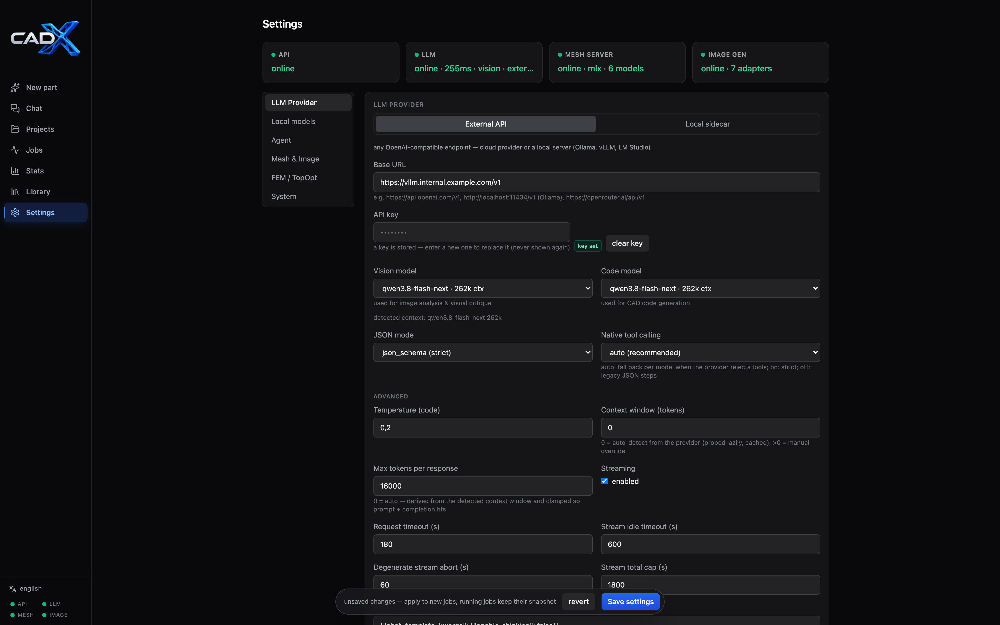

# Getting started

Install and run CADX locally. The fastest path is the one-command setup, which
detects your GPU tier, installs the matching mesh/image adapters and starts the
whole stack.

## Prerequisites

- Docker with Docker Compose
- Python ≥ 3.11 and [`uv`](https://docs.astral.sh/uv/) (`python3 -m pip install uv`)
- Node.js ≥ 20 (native dev mode only)
- Optional, for `mesh`/`hybrid` modes: Apple Silicon (MLX) or an NVIDIA GPU
  (CUDA) — without either, CADX runs in CAD-only mode or with a deterministic
  fake adapter for testing

## One-command start

```bash
./scripts/start.sh          # or: make start
```

`start.sh` runs `setup.sh` if needed, then brings up the docker services
(`postgres`, `redis`, `api`, `worker`, `cad-executor`, `frontend`) plus the
native `mesh-server` sidecar. Flags:

```
scripts/start.sh [--dev] [--tier mlx|cuda|rocm|none|fake] [--fake] [--no-mesh]
                 [--no-setup] [--no-build] [--bind-local] [--dry-run] [--open]
                 [--yes] [--quiet|--verbose|--no-color]
```

All launcher scripts share a common UX: numbered steps with spinners and live
command output on a TTY (plain lines when piped or in CI), a per-run log under
`logs/<name>-<timestamp>.log` (`logs/<name>-latest.log` always points to the
most recent one), preflight checks (docker daemon, port collisions, disk
space), and a failure trap that prints the failing step plus a log tail.
When the mesh port is already held by a *healthy* mesh-server (one that
answers `/v1/health`), `start.sh` adopts it instead of failing or starting a
second one.
`--help` works on every script; `--verbose` streams command output instead of
spinners, `--quiet` reduces output to errors and the summary, `--no-color`/
`NO_COLOR` disables ANSI entirely.

The detected GPU tier decides which mesh adapter gets installed:

| Tier   | Detection                   | Mesh model installed                            |
|--------|-----------------------------|-------------------------------------------------|
| `mlx`  | Apple Silicon (arm64 macOS) | Hunyuan3D-2.1 via MLX port                      |
| `cuda` | local NVIDIA GPU            | TRELLIS.2 (≥20 GB VRAM, override via `MESH_TRELLIS_MIN_VRAM_GB`), else TripoSG |
| `rocm` | local AMD GPU (Linux)       | TripoSG — TRELLIS.2 is CUDA-only. Optional: `--extra hunyuan` adds the Hunyuan3D-2 torch adapters (multiview) |
| `none` | no GPU                      | none — CAD fallback (or `--fake` for tests)     |

ROCm requirements: Linux with the `amdgpu` driver (the setup probes `amd-smi`/
`rocm-smi`/`rocminfo` and `/dev/kfd`). Supported gfx archs out of the box:
gfx1030, gfx110x (RX 7000), gfx120x (RX 9000), gfx942 (MI300). Other archs may
need `HSA_OVERRIDE_GFX_VERSION` — see [Troubleshooting](troubleshooting.md).

A text-to-image adapter is installed alongside the mesh adapter unless you pass
`--skip-image` to `setup.sh` (see [Image generation](image-generation.md)).

> **License note:** Hunyuan models carry the Tencent Community License, which
> excludes the EU/UK/South Korea. TRELLIS.2 and TripoSG are MIT. The active
> model and its license are shown in Settings → "Mesh generator".

## First run

1. Open <http://localhost:8080> → **Settings**.
2. Set the LLM provider base URL, API key and models, then use
   **Test provider** to verify connectivity (see below).
3. Create a project, upload reference images, write a prompt with dimensions
   and press **Generate**.



Provider examples — any OpenAI-compatible endpoint works:

| Provider   | Base URL                            | Models                                   |
|------------|-------------------------------------|------------------------------------------|
| OpenAI     | `https://api.openai.com/v1`         | `gpt-4o`, `gpt-4o-mini`                  |
| OpenRouter | `https://openrouter.ai/api/v1`      | e.g. `anthropic/claude-sonnet-4`         |
| Ollama     | `http://localhost:11434/v1`         | e.g. `qwen2.5vl:32b`, `qwen2.5-coder:32b`|
| LM Studio  | `http://localhost:1234/v1`          | any loaded vision model                  |
| vLLM       | `http://<host>:8000/v1`             | your served model                        |

The vision model must accept image input (it is used for intake and critique).
Local models need to be strong at structured output and code generation — weak
models degrade gracefully into `needs_review` rather than silently producing
bad parts, but expect more repair iterations. See
[recommended settings for local ~27B models](agent-loop.md#recommended-settings-for-local-27b-models).

All application configuration lives in the app database and is edited in the
Settings page — see [Configuration](configuration.md). A `.env` file is only
read by docker compose for infrastructure overrides (`POSTGRES_*`,
`MESH_BASE_URL` seed) — never by the app itself.

## Managing the stack

```bash
scripts/status.sh            # health of all components       (make status)
scripts/status.sh --watch    # refreshing dashboard           (--json also exists)
scripts/stop.sh              # stop everything                (make stop)
scripts/setup.sh             # re-run the installer           (make autosetup)
scripts/setup.sh --doctor    # diagnostics: tier, adapters, env overrides
make help                    # annotated list of every make target (also plain `make`)
make restart                 # stop + start (docker mode; `restart-dev` for native)
make update                  # full self-update: pull + deps + rebuild + restart (docs/updating.md)
make open                    # open the app in the browser
```

`setup.sh` is idempotent and supports `--tier`, `--dev`, `--fake`,
`--extra mps` (hunyuan torch adapters on Apple Silicon), `--extra hunyuan`
(them on the rocm tier), `--skip-mesh`, `--skip-image`, `--dry-run`, `--yes`
and `--doctor`. Before downloading adapter weights it checks free disk space
against a per-tier estimate and asks for confirmation when space is tight.

Before stopping, `stop.sh` verifies that each recorded pid still belongs to
its expected process so a recycled PID is never killed by accident; it also
warns about foreign processes still holding the well-known ports.
`stop.sh --purge` additionally removes the docker volumes (database + data
volumes).

Models, renders and exports persist under `./data/`.

## Native dev mode

`scripts/start.sh --dev` runs api/worker/executor/vite as background processes
instead of docker (logs under `logs/`). The manual equivalent:

```bash
make sync            # uv venv + locked deps (backend)
cd frontend && npm install

# optional: faster FEM solvers (CHOLMOD direct + AMG preconditioner).
# needs SuiteSparse headers — `brew install suite-sparse` (macOS) or
# `apt install libsuitesparse-dev` (Debian/Ubuntu) — plus git + a compiler.
# skipping this is fine: everything falls back to SuperLU/SSOR-CG.
make sync-fem

make infra           # postgres + redis in docker
make migrate         # alembic upgrade head
make dev-api         # FastAPI on :8000 (reload)
make dev-worker      # agent queue worker
make dev-executor    # cad queue worker
make dev-web         # Vite dev server on :5173 (proxies /api)
```

### Mesh server in dev mode

```bash
make mesh-sync                                # uv venv + deps (+ .venv-llm on Apple Silicon)
mesh_server/scripts/install_hunyuan_mlx.sh    # adapter for your tier (see mesh_server/scripts/)
mesh_server/scripts/install_llm.sh            # local-LLM backend (auto-run by mesh-sync on macOS;
                                              # llama.cpp extra / LLAMA_SERVER_BIN elsewhere)
make mesh-server                              # http://localhost:8765 (health: /v1/health)
```

Set `mesh_base_url` to `http://localhost:8765` in Settings for native runs; the
docker stack seeds `http://host.docker.internal:8765` automatically. On a CUDA
box you can instead run the containerized sidecar via the `gpu` compose profile
(`docker compose --profile gpu up -d mesh-server` →
`mesh_base_url=http://mesh-server:8765`). Details:
[mesh generation](mesh-generation.md) and
[`mesh_server/README.md`](../mesh_server/README.md).

## Trying it without infrastructure

The CLI exercises the pipeline in-process — no queues or database needed:

```bash
cd backend
../.venv/bin/uv run cadx run "a 40x20x10 block with 1.5mm edge fillets" --fake   # no LLM needed
../.venv/bin/uv run cadx exec ../path/to/model.py                               # executor pipeline only
../.venv/bin/uv run cadx eval                                                   # scripted benchmarks
../.venv/bin/uv run cadx mesh-gen photo.png -o out.glb                          # direct mesh-server call
../.venv/bin/uv run cadx mesh-process model.glb --dims 80x40x30                 # mesh post-pipeline only
../.venv/bin/uv run cadx mesh-health                                          # mesh-server reachability
../.venv/bin/uv run cadx mcp                                                  # MCP server, stdio (--http for HTTP)
```

## Upgrading from `cadagent`

The system was renamed to **CADX** (package `cadx`, CLI `cadx`, compose project
`cadx`). Existing installs that still use `cadagent_*` docker volumes can keep
the old credentials via `POSTGRES_USER=cadagent POSTGRES_PASSWORD=cadagent
POSTGRES_DB=cadagent` in `.env` (docker-compose overrides only).

## See also

- [Configuration](configuration.md) — all runtime settings and env vars
- [Troubleshooting](troubleshooting.md) — when something fails
- [Web GUI](webgui-ux.md) — what each page does
