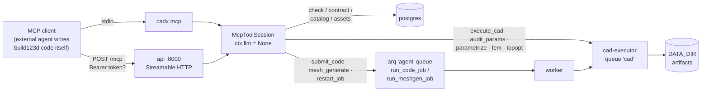

# MCP server

CADX ships a [Model Context Protocol](https://modelcontextprotocol.io) server
so external agents (Claude Code, Devin, your own orchestrator) can drive the
deterministic parts of the pipeline: verify and execute build123d code in the
sandbox, persist versions, run mesh/FEM/topology jobs, manage assets and query
the parts catalog.

## The LLM-free guarantee

**No MCP tool ever triggers the WebGUI's LLM.** The MCP session runs with
`ctx.llm = None` — generation/edit chat tools (`generate_part`, `edit_version`,
`answer_questions`, `enqueue_resume`) are not on the wire, `delete_*` tools are
not on the wire, and `restart_job` refuses LLM-generated (`generate`/`edit`)
versions because those re-run through `run_agent_job`.

The contract inverts the internal flow: **the external agent writes the
build123d code itself**. CADX supplies the conditioning documents
(`codegen_contract`), static verification (`check_code`), sandboxed execution
(`execute_cad`) and the same persistence/job machinery the REST API uses.

## Transports

### stdio — `cadx mcp`

```bash
cd backend && uv run cadx mcp
```

Serves MCP on stdin/stdout — the standard local transport. Point your client
at it as a command server. Sessions are pooled under a constant key, so
`use_project`/`create_project` bindings persist for the lifetime of the
process.

### HTTP — `/mcp` (Streamable HTTP)

The main API mounts the server at **`/mcp`** (POST for JSON-RPC, GET for the
SSE stream, DELETE for session teardown). It also runs standalone:

```bash
uv run cadx mcp --http --port 8001   # serves 127.0.0.1:8001/mcp
```

**Auth:** set `CADX_MCP_TOKEN` to gate the endpoint behind
`Authorization: Bearer <token>` — an empty token (dev default) means open
access. Sessions are pooled per `Mcp-Session-Id`, so a client keeps its bound
project and spawned-job tracking across requests within one MCP session.



## Tool groups

| Group | Tools |
|-------|-------|
| Code loop | `codegen_contract`, `check_code`, `execute_cad`, `audit_params`, `submit_code`, `parametrize_mesh` |
| Mesh | `mesh_generate`, `mesh_preview`, `editable_features`, `edit_feature` |
| Jobs | `list_jobs`, `task_status`, `cancel_job`, `finish_job`, `restart_job`, `wait_job`, `job_status` |
| Assets & images | `list_assets`, `upload_asset`, `view_image`, `remove_bg`, `generate_image` |
| System | `settings_get`, `mesh_health`, `image_models`, `stats` |
| Projects | `use_project` (alias `attach_project`), `create_project`, `list_projects` |
| Inherited deterministic tools | `list_parts`, `list_versions`, `version_details`, `view_render`, `project_settings`, `update_project_settings`, `set_params`, `mesh_edit`, `fem_check`, `optimize_version`, `topopt_resample`, `refine_version`, `organic_restyle`, `search_catalog`, `lookup_part`, `cadlib_lookup`, `quickref`, `search_library`, `library_part`, `save_library_part` |

Most tools need a **bound project** — call `use_project(project_id)` or
`create_project(name)` first (`list_projects` finds ids). Unbound calls return
`{"ok": false, ...}` rather than raising.

A project holds independent **parts** (P1, P2, …) — each owns a root
version tree. `submit_code`/`mesh_generate` accept `part_id`/`part_name`
to file a root under an existing part; omitted, a new part is auto-created
from the prompt. Child operations (`parent_version_id`, restarts, edits)
always stay in the parent's part. `list_parts` enumerates them; `list_jobs`
returns `part_id`/`part` per row.

Spawn tools (`submit_code`, `mesh_generate`, `edit_feature`, `restart_job` and
the inherited `wait`-capable actions) default to **`wait: false`** over MCP —
they return `{job_id, version_id}` immediately; poll `job_status`/`wait_job`.

`settings_get` never returns secrets — stored secrets only appear as `*_set`
booleans (`llm_api_key_set`, `tripo_api_key_set`, `image_api_key_set`,
`hf_token_set`).

## Typical flow

```text
codegen_contract          # read code_contract.md — the sandbox contract
check_code(code)          # static verify: imports, PARAMS, result, std-parts
execute_cad(code)         # run in the sealed sandbox, iterate until ok
submit_code(code)         # persist as a version + enqueue the real job
wait_job(job_id)          # poll until terminal
```

Then use `view_render`, `list_versions`, `fem_check`, `optimize_version`, or
`mesh_generate` on the persisted version like the GUI would.

## Requirements

- **Postgres** — projects/versions/jobs persist there (all tools).
- **Redis + agent worker** — `submit_code`, `mesh_generate`, `restart_job`
  enqueue `run_code_job`/`run_meshgen_job`/`run_params_job`/`run_optimize_job`
  on the agent queue.
- **cad-executor** — `execute_cad`, `audit_params`, `parametrize_mesh`,
  `fem_check`, `optimize_version` dispatch to the `cad` queue. Without a
  running executor (`make dev-executor`) those calls time out into
  `{"ok": false, ...}`.
- **mesh-server sidecar** — `mesh_generate`, `generate_image`, `mesh_health`,
  `image_models` need `mesh_base_url` configured.

`check_code`, `codegen_contract`, `settings_get`, `stats`, catalog/library
tools and all DB reads work with just Postgres.

## Scratch executions

`execute_cad`/`audit_params` run without persisting a version — artifacts land
under the scratch project
`$DATA_DIR/projects/00000000-0000-0000-0000-000000000000/versions/<uuid>/`.
Nothing cleans it automatically; wipe it periodically:

```bash
rm -rf "$DATA_DIR/projects/00000000-0000-0000-0000-000000000000/versions/"*
```

A `version_id` argument pins an execution to a real version's context instead
(hybrid parents get their mesh solid on the payload).

## Result & error shape

Every call returns `CallToolResult`: the result dict is JSON-encoded into a
`TextContent` (and `structuredContent`), `_images` file paths become
`ImageContent` blocks, and `ok: false` maps to `isError` — tool failures are
results, never transport errors.
