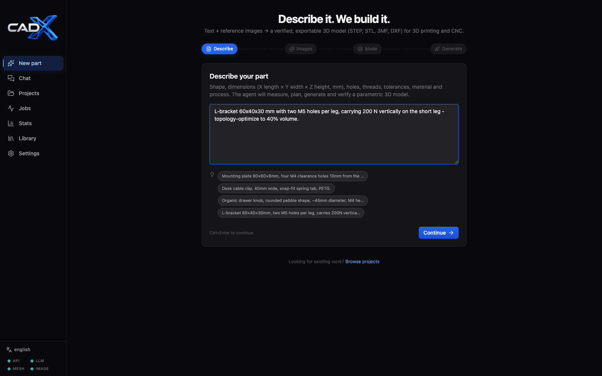
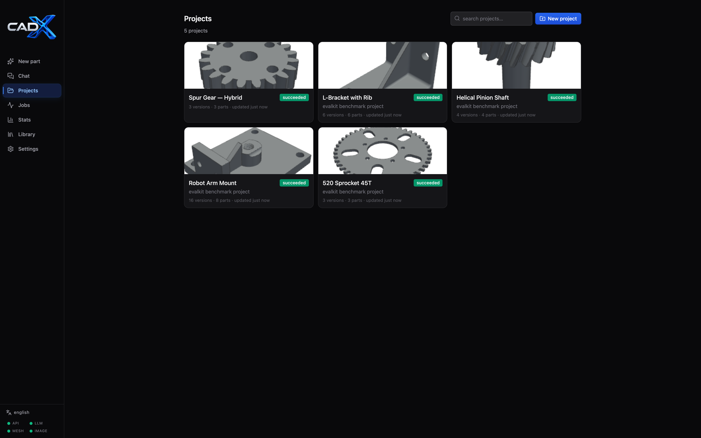
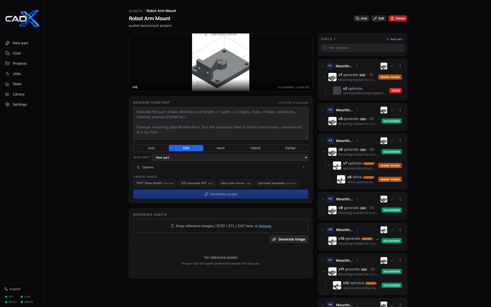
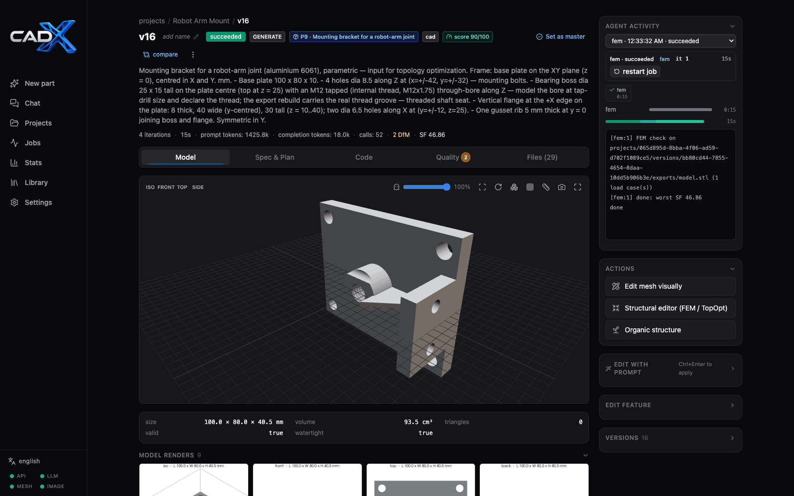

# Web GUI

The React/Vite application exposes the generation, editing, analysis, and
library workflows through ten pages: Start (the new-part wizard), Chat,
Projects, Project, Version, Mesh editor, Jobs, Stats, Library, and
Settings. The UI is
served by nginx at `:8080` in Docker mode or Vite at `:5173` in native
development mode.


The **Start page** (`/`) is a guided four-step wizard for creating a brand-new
part: **Describe** the part (with clickable example prompts) → **Images**
(upload references or generate a concept image — both optional) → **Mode**
(explained mode cards with a heuristic suggestion) → **Review & generate**
(auto-named project, run options, one-click start). The project is created
eagerly on entering the Images step — uploads and AI image generation need a
project id — with a name auto-derived from the prompt (editable in Review;
abandoned drafts can be discarded via *start over* or deleted on Projects).
After starting, the wizard shows the job's live progress, provisional renders and
clarifying questions inline (same stream as the version page); on success it
hands off to the version page, on failure it offers *Back & adjust* (draft
preserved). Wizard state is kept in localStorage, so reloading resumes —
including a running job.




The **Jobs** page (`/jobs`) lists active and recently finished jobs across
projects with live progress, iteration/step labels, runtime and
cancel/finish/retry actions; a nav badge shows the active count. Status
filter chips plus a job-type dropdown narrow the list, `waiting_for_input`
jobs show their first pending question inline, and a *show more* control
paginates older history.


The **Chat page** (`/chat`) is a persistent conversation with the agent —
it can create projects, generate, edit, analyse and optimise parts as tools,
with spawned jobs rendered as live cards and the latest version in a 3D
panel. See [chat.md](chat.md).


## User workflows

### Projects and generation

- The Start-page wizard is the fastest way in; the **Projects** page
  (`/projects`) lists, searches, renames and deletes projects and also offers a
  classic "New project" dialog for empty/import-style projects.
- Upload and manage image/reference assets.
- Start a generation with a text prompt, selected assets, mode, per-run options,
and optional reusable library parts.
- Modes: `Auto`, `CAD`, `Mesh`, `Hybrid`, `TopOpt`. Mesh and Hybrid require an
  available mesh server and at least one image; TopOpt generates a base CAD
  design then optimizes it.
- Per-run options include manufacturing process, material, FEM analysis,
  topology optimization/target volume, and standard fasteners.





### Version detail

The Version page provides:

- Overview: 3D viewer, dimensions/volume/validity, renders, exports.
- Spec: extracted PartSpec and construction plan.
- Code: generated source and parameter controls.
- Quality: measured-anchor table (AnchorsPanel), DfM warnings, measured
  issues, vision critique, BOM, and FEM report including stress/deformation
  artifacts when available.
- Files: all version artifacts, downloads, and saving successful/reviewed
  versions to the reusable part library.
- Side panel: job progress/log and history, prompt/image edits, mode/options,
  inherited or selected library parts, parameter-only reruns, parametric
  through-hole resize (FeatureEditPanel), manual topology optimization for
  eligible versions, and the version tree with per-subtree collapse.

Edits create child versions. Library selections are carried forward by default
and can be changed in the edit form. The API distinguishes an omitted selection
(inherit) from an explicit empty list (clear).

A **compare** toggle on the overview opens a version picker and splits the
viewer into a side-by-side `a`/`b` `Viewer3D` pair plus a ComparePanel:
volume/bbox/solid/face deltas and added/removed material from
`GET /versions/{a}/compare/{b}`, plus a params diff table — when OCC
booleans are skipped the panel still shows the partial result with a
`boolean diff` warning. The viewer toolbar also carries a two-click
surface-distance **measure** tool (the same one the mesh editor
documents).

Any version can be marked as the **master** of its part (header toggle) —
the user-verified pick an assembly agent later selects. At most one per
part: accepting another version unmarks the previous one, and newer
versions never inherit the flag. Accepted versions show a green check badge
in the version tree, the part card displays a `v{n}` master chip, and the
delete dialog warns before removing a master (the part is left without
one — reassignment is a manual choice).




### Mesh editor (`/versions/<id>/edit`)

A dedicated page for visual, mesh-level editing of any finished version. The
tool panel builds a stack of validated `MeshOp` operations — the same
`OPS_REGISTRY` replay the executor uses for agent-side mesh refinement:

- **Orient / Rotate / Mirror / Scale** (uniform or per-axis)
- **Flatten bottom, Slice, Crop box, Clip height** — slice and clip planes and
  crop corners can be picked on the model surface *or* dragged with an
  on-screen transform gizmo (mm coordinates)
- **Smooth, Smooth-preserve, Decimate, Remesh, Symmetrize, Shell**
- **Drill holes** — vertical holes at picked XY points (dia / depth /
  countersink), optionally from measured anchors
- **Boolean add/cut** with a box/cylinder/sphere primitive — place by clicking
  the surface, then fine-tune with a move/rotate gizmo (ghost preview)
- **Keep largest / Drop small bodies / Repair**
- **Measure** — two-click surface distance (not recorded)

While a pick tool is armed the left button belongs to the tool — orbit the
camera with the right mouse button (or two-finger drag on touch).

The op stack supports per-op removal, reorder, duplication, inline arg
editing, undo and reset; a failing op is highlighted in red using the
`failed_op` index + per-op report returned by the preview.

**Preview** runs the same synchronous baseline + ops replay the executor
uses, but in-process (no queue round-trip) with a cached baseline, and swaps
the viewer to a server-generated GLB (face count, bbox, watertight stats).
Stacks containing only rigid ops past the recorded prefix (orient, rotate,
mirror, scale) are evaluated instantly client-side — the model is
transformed locally, no request at all ("instant preview" badge). With
*auto* enabled, geometry-op stacks re-preview automatically ~0.7 s after the
last change. **Apply as new version** creates an immutable `mesh_edit` child
version: for mesh-mode parents the full baseline + ops replay runs on
`mesh/mesh_raw.glb`, for every other parent the ops run directly on the
finished STL (`ops_only` — no re-orient/re-scale). Drafts are autosaved on
the version (`options.ui_editor.ops`, merged server-side) so reopening the
editor restores the stack.


### Structural editor (FEM / TopOpt regions)

The structural editor paints boundary regions directly on the model surface
with a brush (per-region radius, mm) and supports the full `RegionSpec`
vocabulary:

- **Support regions** (blue) — fixed nodes per load case
- **Load regions** (red) — force vector `[fx,fy,fz]` N *or* pressure MPa per
  load (pressure follows the region's stored surface normal)
- **Keep regions** (green) — TopOpt design-preserve volumes

Region kinds: `points` (painted or surface-picked — points + radius +
averaged surface normal), `face`/`surface` (+axis), `area` (XY footprint),
`cylinder`, `box`, `hole`/`anchor`/`bore` (measured feature anchors, 1-based
index) and `all`. Geometric regions offer click-to-place centers and an
expandable detail row (center, diameter/edge, margin, label).

Besides freehand painting, each region list offers three direct-viewer pick
tools with hover highlighting:

- **face** — click surface patches; triangles are clustered into facets by a
  crease angle (adjustable in the header), the hovered facet lights up and
  each click appends its surface points to the region
- **edge** — hover shows the facet boundary loop nearest the cursor; a click
  stores the ordered loop vertices as the region's points
- **hole** — click inside or near a measured hole/thread/bore; a translucent
  sleeve marks the hovered feature and the click appends a `hole`/`bore`
  region bound to that anchor index (the anchor markers themselves are
  clickable, too)

While any paint/pick tool is armed, the left button belongs to the tool and
**right-drag orbits** the camera (wheel zooms, middle pans; touch: one
finger paints, two orbit). `Esc` or the ✓ button disarms the tool; an empty
just-armed region is dropped automatically. Painted and picked regions both
render as a dot trail sized by the region radius plus a vertex-coloured fill
— the live approximation of the voxel-domain selection — and support an
**eraser** and per-stroke **undo**.

Three actions share the declared cases: **Check regions** (server-side voxel
resolution → hit counts, warnings, and a 3D overlay of the *resolved* cell
selection — `fem-preview` returns subsampled cell centres per case; legacy
2D PNGs via `render_pngs`), **FEM check** (standalone stress analysis
written to the same version, `needs_review` when safety factor < 1), and
**Optimize** (SIMP TopOpt child version with keep regions). Selections,
material and volume fraction autosave under `options.ui_editor` (merged —
the mesh-editor ops draft and structural state no longer clobber each
other).


### Organic editor (pseudo-TopOpt restyle)

The **Organic structure** action on a finished version opens a dialog that
restyles the part into a deterministic organic structure — `gyroid`,
`trabecular`, `voronoi` or `branches` — with a live preview running the same
mesh op the commit replays. Simplified controls (style, preserve-surface,
density, cell size, seed) sit up front; skin/base/threshold/quality move to
an Advanced expander. Keep + carve brushes paint protected and erased zones,
cyan markers show the detected feature anchors auto-keep protects, a compare
toggle flips to the original part, and the status bar reports the live
surface-coverage metric. Aesthetic only, no FEM. See [organic.md](organic.md).


### Settings

Settings (`/settings`) is organized into tabs — **LLM Provider**, **Local
models** (Hugging Face token + sidecar model downloads/removal), **Agent**,
**Mesh & Image** (local mesh generator + image generation on the same sidecar),
**FEM / TopOpt**, and **System** — with a floating save bar that applies to new
jobs only. Four status cards on top show live service health: API, LLM (a real
probe via `GET /api/settings/health` — "online · latency", not just "key set"),
Mesh server (device + available mesh models), and Image gen (adapter count on
the same sidecar). The same four signals appear as dots in the sidebar footer.


### Part library (`/library`)

The **Library page** holds the user part library — a searchable/filterable card
grid of reusable STEP/STL bodies and saved code templates with upload,
rename/caption editing, a detail modal with a 3D preview (STL renders directly,
STEP/templates show their source version's GLB when available), download, and
deletion — plus the collapsible standard-parts catalog (bd_warehouse). Parts may
be pinned on generation/edit or discovered and attached by the agent's library
tools. See [parts-library.md](parts-library.md).


### Statistics (`/stats`)

The Stats page aggregates generation history across all projects, with a
7d / 30d / 90d / all-time range selector. Backed by `GET /api/stats?days=N`
(read-only, no migration needed). Sections:

- KPI cards: versions/projects/jobs, success rate, average score and
  iterations, LLM tokens and calls, tokens per succeeded version, total
  compute time, artifact storage — plus a secondary strip with mesh
  generations + cache rate, FEM analyses + average worst safety factor,
  assets and library parts.
- Trends: versions + jobs created per day (bars), job outcomes by finish day
  (stacked succeeded/failed bars) overlaid with the average score line
  (secondary axis), and LLM tokens per day.
- Mode performance: per `resolved_mode` comparison — versions, pass rate
  (bar), average score, average iterations and tokens.
- Distributions: version status, resolved generation mode, job status donuts
  with semantic colors (succeeded green, needs_review amber, failed red).
- Quality: score histogram (`<40`, `40-59`, `60-79`, `80-100`, red→green) and
  issue sources aggregated from `Version.issues` (major/minor per source).
- LLM usage: tokens / calls / average latency per model and per pipeline step;
  per-step wall time comes from `Job.live.step_history`.
- Performance: job count / failure count / avg / p50 / max wall duration per
  job type.
- Failures: most common error lines and the pipeline step jobs died in.
- Data inventory: version kinds, assets, artifact kinds and mesh models used.
- Projects: per-project versions, success share, average score, tokens and
  last activity with deep links into the project.

Charts use Recharts; the page is lazy-loaded so the chart bundle does not
inflate the initial page load.


## Agent visibility

The UI consumes `VersionDetail` and artifact endpoints; fields are displayed in
context rather than duplicated across pages. Agent tool calls and their results
are captured in backend trace records for debugging. The current JobLog shows
phase-level progress, not individual tool-call payloads. Tool schemas are
step-scoped: edit tools are not available in critique, and critique library
tools are read-only.

## Verification checklist

Run the commands from the repository root:

```bash
cd frontend && npx tsc --noEmit && npm run build
cd ../backend && ../.venv/bin/uv run pytest tests/unit/test_api.py tests/unit/test_library.py -q
```

Manual smoke test:

1. Open the Library page, upload a STEP/STL body, edit its name/caption,
   download it, and remove it.
2. Generate a CAD model with a library part selected; confirm its id is stored
   in version details. Save the resulting version as a template and confirm it
   appears in the Library page and the project picker.
3. Edit a version, confirm its selected library parts are preselected, change
   the selection, and verify the child version reflects the new selection.
4. Enable FEM or TopOpt options, complete a run with explicit load cases, and
   inspect the Quality and Files tabs. Trigger manual topology optimization on
   a completed non-TopOpt version and confirm it opens a child version.
5. Confirm the job log continues polling while queued/running and stops polling
   after completion.

## Scope and limitations

The GUI is for a local, single-user deployment; it does not provide
authentication or multi-user library isolation. FEM/TopOpt values are
engineering estimates, not certification. The mesh editor operates on
tessellated geometry — it records replayable `MeshOp` transforms, it does not
patch parametric code; booleans are capped at 500k faces (decimate first).
Region painting and surface picks (face/edge facets) select near-surface
voxel cells within the region radius — thin features below ~2 voxel pitches
may not resolve reliably. See [fem-topopt.md](fem-topopt.md).

## See also

- [Image editing](image-editing.md) — the asset editor
- [Image generation](image-generation.md) — generated-image assets and sketches
- [Parts library](parts-library.md) — catalog, cadlib and user library
- [HTTP API](api.md) — the endpoints behind these pages